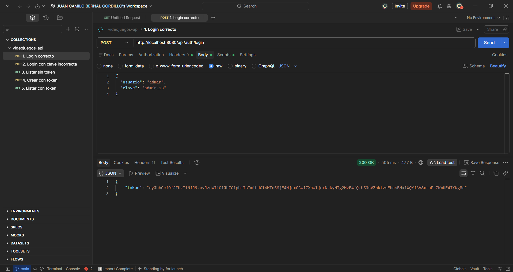
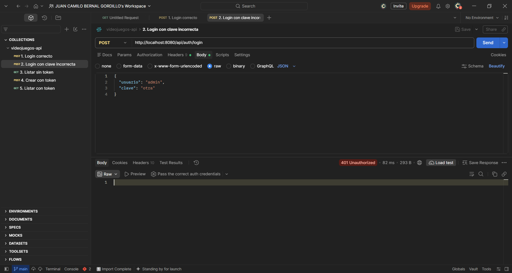
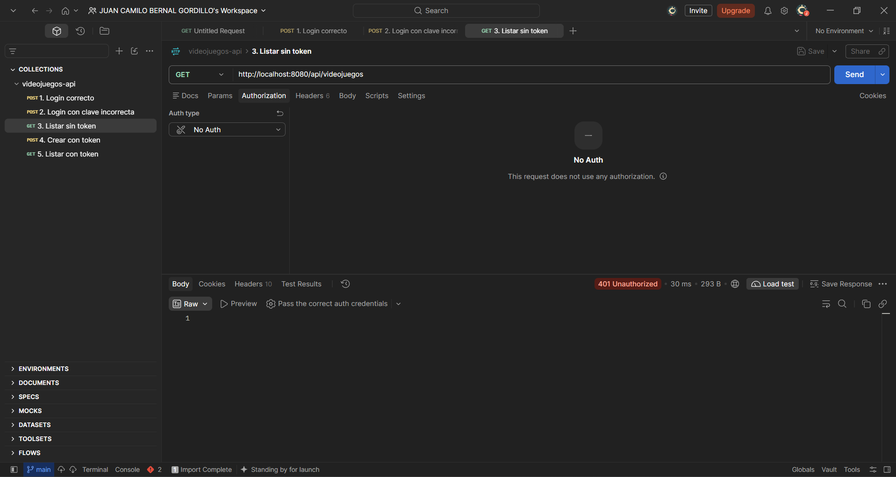
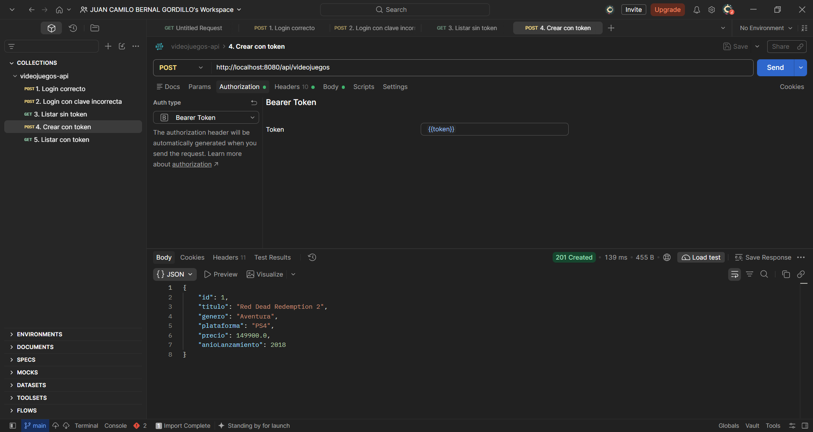
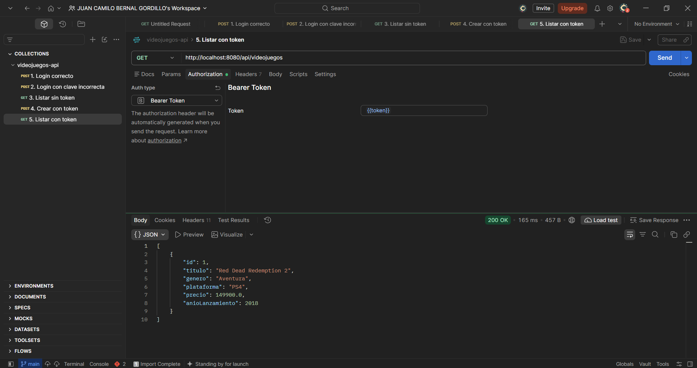

# Semana 11 · Proteger la API con JWT — Catálogo de Videojuegos

| | |
| --- | --- |
| **Estudiante** | Juan Camilo Bernal Gordillo |
| **Materia** | Complementaria III - Profundización Desarrollo Fullstack (2026-B) |
| **Usuario de GitHub** | [JuanBernalCorhuila](https://github.com/JuanBernalCorhuila) |

Hasta la semana pasada cualquiera podía consultar, crear o borrar videojuegos en mi API. Esta semana le agregué seguridad: ahora hay un login que, si el usuario y la clave son correctos, devuelve un token JWT, y los endpoints del catálogo solo responden si la petición trae ese token en la cabecera `Authorization: Bearer <token>`. Sin token la API responde `401 Unauthorized`.

Aquí se ven las dos ideas de la clase: el login y el token son la **autenticación** (comprobar quién soy), y las reglas que dicen qué rutas son públicas y cuáles exigen estar autenticado son la **autorización** (qué puedo hacer).

El proyecto sigue siendo el mismo `videojuegos-api` con Spring Boot (Java 17, Maven) y H2 en memoria. La entidad, el CRUD y sus endpoints no cambiaron; lo nuevo es la capa de seguridad.

## 1. Estructura del proyecto

```
02-optional-activity/
├── README.md
└── videojuegos-api/
    ├── pom.xml
    ├── evidencias/                                  (capturas de Postman)
    ├── postman/
    │   └── videojuegos-api.postman_collection.json  (colección con las pruebas)
    └── src/main/
        ├── java/com/corhuila/videojuegos/
        │   ├── VideojuegosApiApplication.java
        │   ├── model/Videojuego.java
        │   ├── repository/VideojuegoRepository.java
        │   ├── service/VideojuegoService.java
        │   ├── controller/
        │   │   ├── VideojuegoController.java        (CRUD, ahora protegido)
        │   │   └── AuthController.java              (nuevo: POST /api/auth/login)
        │   ├── dto/
        │   │   ├── LoginRequest.java                (nuevo: usuario y clave que llegan al login)
        │   │   └── LoginResponse.java               (nuevo: el token que devuelve el login)
        │   └── security/
        │       ├── JwtService.java                  (nuevo: crea y valida los tokens)
        │       ├── JwtFilter.java                   (nuevo: lee el token de cada petición)
        │       └── SecurityConfig.java              (nuevo: qué rutas son públicas y cuáles no)
        └── resources/application.properties         (clave secreta y duración del token)
```

Puse las clases de seguridad en su propio paquete `security` para no mezclarlas con las capas del CRUD, y los datos de entrada y salida del login en `dto`, porque no son una entidad de la base de datos.

## 2. Dependencias nuevas

En el `pom.xml` agregué Spring Security, que es el que bloquea las rutas, y la librería JJWT, que sirve para crear y validar los tokens:

```xml
<dependency>
    <groupId>org.springframework.boot</groupId>
    <artifactId>spring-boot-starter-security</artifactId>
</dependency>
<dependency>
    <groupId>io.jsonwebtoken</groupId>
    <artifactId>jjwt-api</artifactId>
    <version>0.12.6</version>
</dependency>
```

(JJWT también lleva `jjwt-impl` y `jjwt-jackson`, que solo se necesitan al ejecutar.)

## 3. Cómo funciona

El flujo completo es este:

```
1) POST /api/auth/login  {usuario, clave}        ──►  se comprueba el usuario y la clave
2)                        ◄── 200 { "token": "eyJ..." }
3) GET /api/videojuegos   Authorization: Bearer eyJ...  ──►  el filtro valida el token
4)                        ◄── 200 con los datos (o 401 si no hay token o no es válido)
```

### El usuario y la clave

Para probar dejé un usuario en memoria, `admin` con clave `admin123`. La clave no se guarda en texto plano: se cifra con BCrypt antes de guardarla, y al hacer login Spring compara la clave enviada contra ese hash.

```java
@Bean
public UserDetailsService usuarios(PasswordEncoder encoder) {
    return new InMemoryUserDetailsManager(
            User.withUsername("admin")
                    .password(encoder.encode("admin123"))
                    .roles("ADMIN")
                    .build());
}
```

### El login (`AuthController`)

Recibe el usuario y la clave. Si son correctos devuelve el token; si no, responde `401`:

```java
@PostMapping("/login")
public ResponseEntity<LoginResponse> login(@RequestBody LoginRequest datos) {
    try {
        authenticationManager.authenticate(
                new UsernamePasswordAuthenticationToken(datos.usuario(), datos.clave()));
    } catch (AuthenticationException e) {
        return ResponseEntity.status(HttpStatus.UNAUTHORIZED).build();
    }
    return ResponseEntity.ok(new LoginResponse(jwtService.generarToken(datos.usuario())));
}
```

### El token (`JwtService`)

El token lleva el nombre del usuario, la fecha en que se creó y la fecha en que vence (una hora después). Se firma con una clave secreta que está en `application.properties`, así que si alguien lo modifica la firma deja de coincidir. El token nunca lleva la contraseña.

```java
return Jwts.builder()
        .subject(usuario)
        .issuedAt(ahora)
        .expiration(new Date(ahora.getTime() + expiracionMs))
        .signWith(clave)
        .compact();
```

```properties
jwt.secret=clave-secreta-videojuegos-api-corhuila-2026
jwt.expiracion-ms=3600000
```

### El filtro (`JwtFilter`)

Se ejecuta en cada petición. Si viene la cabecera `Authorization: Bearer ...`, saca el token y lo valida (firma y fecha de vencimiento). Si es válido, marca la petición como autenticada; si no viene o no es válido, la deja sin autenticar.

```java
String header = request.getHeader("Authorization");
if (header != null && header.startsWith("Bearer ")) {
    String token = header.substring(7);
    try {
        String usuario = jwtService.obtenerUsuario(token);
        var auth = new UsernamePasswordAuthenticationToken(usuario, null, List.of());
        SecurityContextHolder.getContext().setAuthentication(auth);
    } catch (JwtException | IllegalArgumentException e) {
        // token inválido o vencido: la petición sigue sin autenticar
    }
}
```

### Qué rutas están protegidas (`SecurityConfig`)

El login y la documentación de Swagger quedan públicos; todo lo demás, que es el CRUD de `/api/videojuegos`, exige el token. Como es una API REST, no uso sesión en el servidor (stateless): cada petición se valida solo con su token. Y cuando una petición llega sin autenticar, la API responde `401 Unauthorized`.

```java
.authorizeHttpRequests(auth -> auth
        .requestMatchers("/api/auth/login").permitAll()
        .requestMatchers("/swagger-ui.html", "/swagger-ui/**", "/v3/api-docs/**").permitAll()
        .requestMatchers("/error").permitAll()
        .anyRequest().authenticated())
.exceptionHandling(e -> e.authenticationEntryPoint(new HttpStatusEntryPoint(HttpStatus.UNAUTHORIZED)))
.addFilterBefore(new JwtFilter(jwtService), UsernamePasswordAuthenticationFilter.class);
```

La ruta `/error` la dejé pública porque es la que usa Spring internamente para armar las respuestas de error; si no, un error como un JSON mal escrito terminaría saliendo como `401` en vez de `400`.

## 4. Cómo ejecutarla

Se necesita Java 17 o superior y Maven. Desde la carpeta `videojuegos-api`:

```bash
mvn spring-boot:run
```

Con la aplicación arriba quedan disponibles:

- El login: `POST http://localhost:8080/api/auth/login`
- La API (con token): `http://localhost:8080/api/videojuegos`
- Swagger UI: `http://localhost:8080/swagger-ui.html`

## 5. Endpoints

| Método | URL | Acción | Token | Respuesta |
|---|---|---|---|---|
| POST | `/api/auth/login` | Iniciar sesión | No | `200 OK` con el token o `401` si los datos no coinciden |
| GET | `/api/videojuegos` | Listar todos | Sí | `200 OK` |
| GET | `/api/videojuegos/{id}` | Obtener uno | Sí | `200 OK` o `404 Not Found` |
| POST | `/api/videojuegos` | Crear | Sí | `201 Created` |
| PUT | `/api/videojuegos/{id}` | Actualizar | Sí | `200 OK` o `404 Not Found` |
| DELETE | `/api/videojuegos/{id}` | Borrar | Sí | `204 No Content` o `404 Not Found` |

Todos los endpoints de `/api/videojuegos` responden `401 Unauthorized` si la petición no trae un token válido.

El login recibe este JSON:

```json
{
  "usuario": "admin",
  "clave": "admin123"
}
```

## 6. Pruebas con Postman

Probé el flujo completo: hice login, intenté entrar sin token y luego repetí con el token. Las peticiones están en `videojuegos-api/postman/videojuegos-api.postman_collection.json`. El login tiene un pequeño script que guarda el token en la variable `{{token}}` de la colección, y las peticiones protegidas lo envían en la pestaña *Authorization* como *Bearer Token*, así no hay que copiarlo y pegarlo a mano.

**1. Login correcto** — `POST /api/auth/login` con `admin` / `admin123`. Responde `200 OK` y devuelve el token.



**2. Login con clave incorrecta** — `POST /api/auth/login` con una clave que no es. Responde `401 Unauthorized` y no entrega ningún token.



**3. Sin token** — `GET /api/videojuegos` sin la cabecera `Authorization`. Responde `401 Unauthorized`: el endpoint está protegido.



**4. Crear con token** — `POST /api/videojuegos` con `Authorization: Bearer <token>` y los datos de Red Dead Redemption 2. Responde `201 Created` con `id: 1`.



**5. Listar con token** — `GET /api/videojuegos` con el mismo token. Ahora responde `200 OK` con el videojuego creado.



La misma petición que sin token respondía `401`, con el token responde `200`. Así la API ya no queda abierta: primero hay que iniciar sesión y después cada petición se valida con su token.
