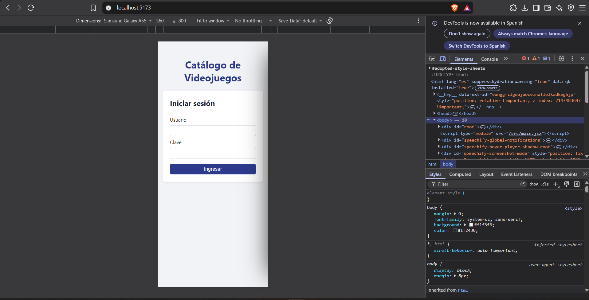
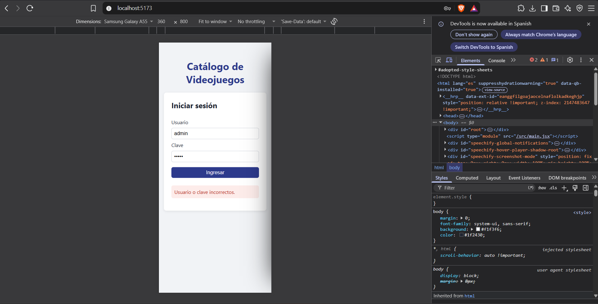
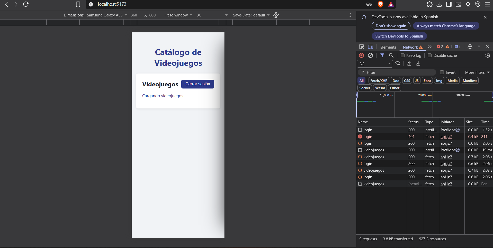
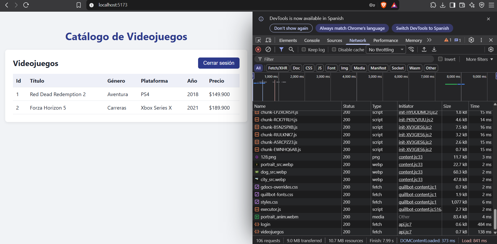
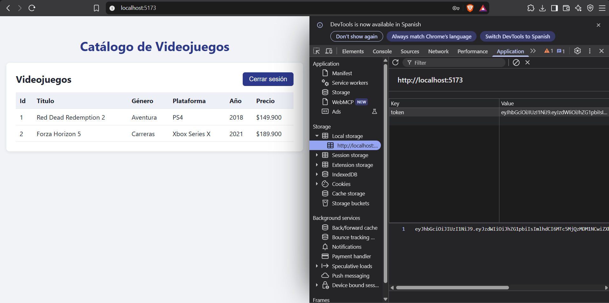
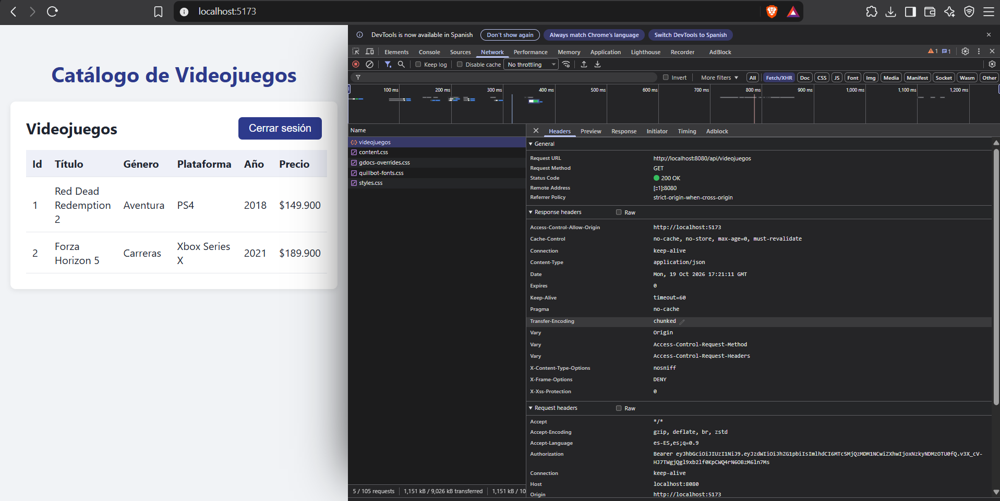
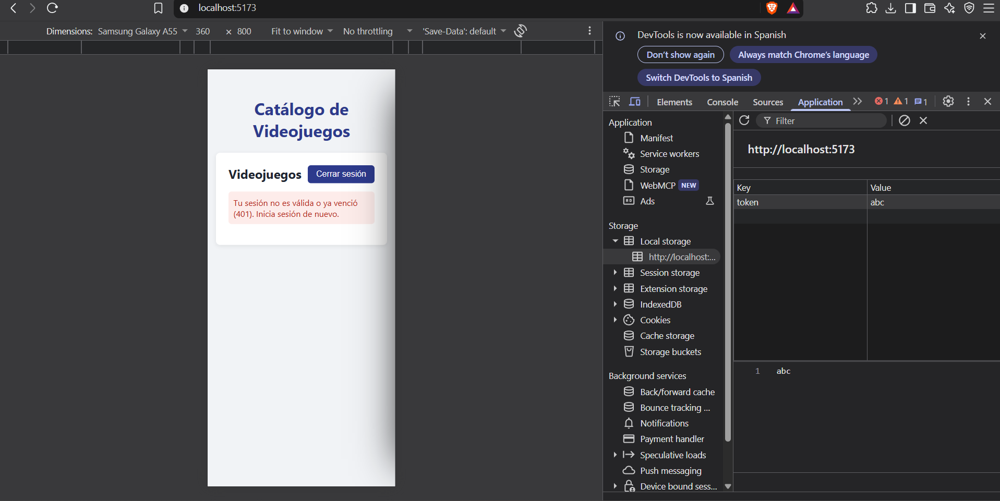
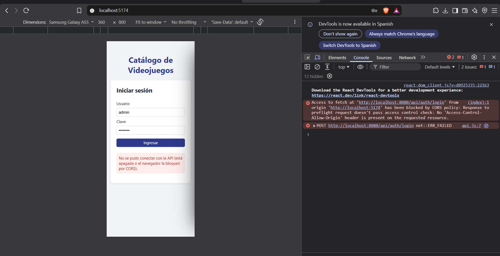

# Semana 12 · Integrar frontend y backend — Catálogo de Videojuegos

| | |
| --- | --- |
| **Estudiante** | Juan Camilo Bernal Gordillo |
| **Materia** | Complementaria III - Profundización Desarrollo Fullstack (2026-B) |
| **Usuario de GitHub** | [JuanBernalCorhuila](https://github.com/JuanBernalCorhuila) |

Hasta la semana pasada mi API de videojuegos ya pedía login y token, pero solo la probaba desde Postman. Esta semana le hice un frontend en React que la usa de verdad: inicio sesión desde una pantalla de login, guardo el token que devuelve la API y con ese token pido el catálogo protegido y lo muestro en una tabla. Mientras llegan los datos se ve un mensaje de carga y, si algo falla, un mensaje de error en lugar de una pantalla en blanco.

Para que el navegador dejara al frontend (`localhost:5173`) hablar con la API (`localhost:8080`) tuve que habilitar CORS en el backend.

```
[ React (localhost:5173) ] ──POST /api/auth/login──►  [ API Spring Boot (localhost:8080) ] ──► [ H2 ]
        │  guarda el token en localStorage
        └──GET /api/videojuegos (Authorization: Bearer <token>)──►  responde JSON ──► tabla
```

## 1. Estructura del proyecto

```
02-optional-activity/
├── README.md
├── evidencias/                                  (capturas de las pruebas)
├── videojuegos-api/                             (backend, el mismo de la semana 11)
│   ├── pom.xml
│   └── src/main/
│       ├── java/com/corhuila/videojuegos/
│       │   ├── VideojuegosApiApplication.java   (cambió: carga dos videojuegos al arrancar)
│       │   ├── model/Videojuego.java
│       │   ├── repository/VideojuegoRepository.java
│       │   ├── service/VideojuegoService.java
│       │   ├── controller/
│       │   │   ├── VideojuegoController.java    (cambió: @CrossOrigin)
│       │   │   └── AuthController.java          (cambió: @CrossOrigin)
│       │   ├── dto/
│       │   │   ├── LoginRequest.java
│       │   │   └── LoginResponse.java
│       │   └── security/
│       │       ├── JwtService.java
│       │       ├── JwtFilter.java
│       │       └── SecurityConfig.java          (cambió: activa CORS en la seguridad)
│       └── resources/application.properties
└── videojuegos-front/                           (nuevo: frontend en React con Vite)
    ├── package.json
    ├── vite.config.js
    ├── index.html
    └── src/
        ├── main.jsx                             (arranca React)
        ├── App.jsx                              (decide si mostrar el login o el catálogo)
        ├── App.css                              (estilos)
        ├── api.js                               (todas las llamadas a la API)
        └── components/
            ├── Login.jsx                        (formulario de login)
            └── Videojuegos.jsx                  (tabla del catálogo)
```

En el backend no cambié la entidad, las capas ni los endpoints; solo agregué CORS y unos datos iniciales. En el frontend separé las llamadas a la API (`api.js`) de los componentes que pintan la pantalla, y los estilos van en su propio archivo.

## 2. Cambios en el backend

### CORS

CORS es una protección del navegador: si una página que está en un origen (`http://localhost:5173`) intenta llamar a una API en otro (`http://localhost:8080`), el navegador bloquea la respuesta a menos que la API diga que ese origen está permitido. Postman no es un navegador, por eso la semana pasada nunca apareció este problema.

Le agregué `@CrossOrigin` a los dos controladores, porque el frontend usa los dos: el de login y el del catálogo.

```java
@CrossOrigin(origins = "http://localhost:5173")
@RestController
@RequestMapping("/api/videojuegos")
public class VideojuegoController { /* ... */ }
```

Con Spring Security eso solo no basta. Cuando el navegador va a enviar una petición con la cabecera `Authorization`, primero manda una petición previa de tipo `OPTIONS` (el *preflight*) para preguntar si está permitido, y esa petición nunca lleva el token. Sin más, la seguridad la rechazaba con `401` y el navegador cancelaba la petición real. Por eso en `SecurityConfig` activé CORS dentro de la cadena de seguridad; así Spring Security lee los `@CrossOrigin` de los controladores y responde ese preflight antes de exigir el token:

```java
http
        .cors(Customizer.withDefaults())
        .csrf(csrf -> csrf.disable())
        // ... lo demás quedó igual que la semana 11
```

Solo permití `http://localhost:5173`, que es donde corre el frontend; desde cualquier otro origen el navegador sigue bloqueando las peticiones.

### Datos iniciales

H2 es una base de datos en memoria y arranca vacía cada vez. Para que el frontend tenga algo que mostrar apenas inicio sesión, en `VideojuegosApiApplication` cargo dos videojuegos al arrancar la aplicación, los mismos que usé en semanas anteriores:

```java
@Bean
CommandLineRunner datosIniciales(VideojuegoRepository repo) {
    return args -> {
        repo.save(new Videojuego("Red Dead Redemption 2", "Aventura", "PS4", 149900, 2018));
        repo.save(new Videojuego("Forza Horizon 5", "Carreras", "Xbox Series X", 189900, 2021));
    };
}
```

## 3. El frontend

Lo hice con React y Vite. En `vite.config.js` dejé fijo el puerto `5173`, porque es justo el origen que la API tiene permitido en CORS.

### Las llamadas a la API (`api.js`)

Puse la dirección del backend en una sola constante, así no queda repetida por todo el proyecto. Aquí están las dos funciones que usa la aplicación.

`login` envía el usuario y la clave y, si son correctos, guarda el token en `localStorage` para no perderlo al recargar la página:

```js
const API_URL = "http://localhost:8080/api";

export async function login(usuario, clave) {
  const res = await pedir(`${API_URL}/auth/login`, {
    method: "POST",
    headers: { "Content-Type": "application/json" },
    body: JSON.stringify({ usuario, clave }),
  });
  if (res.status === 401) throw new Error("Usuario o clave incorrectos.");
  if (!res.ok) throw new Error("Error " + res.status);

  const datos = await res.json();
  localStorage.setItem("token", datos.token);
  return datos.token;
}
```

`getVideojuegos` lee el token guardado y lo envía en la cabecera `Authorization: Bearer <token>`, que es lo que revisa el filtro JWT de la API. Si la API responde `401` es porque el token no es válido o ya venció:

```js
export async function getVideojuegos() {
  const token = localStorage.getItem("token");
  const res = await pedir(`${API_URL}/videojuegos`, {
    headers: { Authorization: `Bearer ${token}` },
  });
  if (res.status === 401) throw new Error("Tu sesión no es válida o ya venció (401). Inicia sesión de nuevo.");
  if (!res.ok) throw new Error("Error " + res.status);
  return res.json();
}
```

Las dos usan `pedir`, que envuelve a `fetch`. `fetch` solo falla por su cuenta cuando no llega ninguna respuesta, que es lo que pasa si la API está apagada o si el navegador la bloquea por CORS; en ese caso muestro un mensaje claro en vez del "Failed to fetch" del navegador.

### Login (`Login.jsx`) y cambio de pantalla (`App.jsx`)

El formulario llama a `login`. Mientras espera, el botón se desactiva y dice "Ingresando..."; si falla, aparece el mensaje de error debajo.

```jsx
async function enviar(e) {
  e.preventDefault();
  setCargando(true);
  setError(null);
  try {
    const token = await login(usuario, clave);
    onLogin(token);
  } catch (err) {
    setError(err.message);
    setCargando(false);
  }
}
```

`App.jsx` guarda el token en el estado: si hay token muestra el catálogo y si no, el login. Al abrir la página lo toma de `localStorage`, así que si ya había iniciado sesión entro directo. El botón "Cerrar sesión" borra el token y vuelve al login.

```jsx
const [token, setToken] = useState(localStorage.getItem("token"));
// ...
{token ? <Videojuegos onCerrarSesion={cerrarSesion} /> : <Login onLogin={setToken} />}
```

### Catálogo con estados de carga y error (`Videojuegos.jsx`)

Cuando aparece la pantalla, `useEffect` pide los videojuegos. La variable `estado` dice qué se muestra: "cargando" mientras llega la respuesta, la tabla cuando llegan los datos y el mensaje de error si algo falla. Así la pantalla nunca queda en blanco.

```jsx
const [estado, setEstado] = useState("cargando"); // "cargando" | "ok" | "error"

useEffect(() => {
  getVideojuegos()
    .then((datos) => {
      setVideojuegos(datos);
      setEstado("ok");
    })
    .catch((err) => {
      setError(err.message);
      setEstado("error");
    });
}, []);
```

```jsx
{estado === "cargando" && <p className="cargando">Cargando videojuegos...</p>}
{estado === "error" && <p className="error">{error}</p>}
```

## 4. Cómo ejecutarlo

Se necesitan Java 17 o superior, Maven y Node.js (versión 20.19 o superior). Hay que levantar los dos proyectos, cada uno en su propia terminal.

**Backend**, desde la carpeta `videojuegos-api`:

```bash
mvn spring-boot:run
```

**Frontend**, desde la carpeta `videojuegos-front` (el `npm install` solo hace falta la primera vez):

```bash
npm install
npm run dev
```

Luego se abre `http://localhost:5173` en el navegador y se inicia sesión con el usuario `admin` y la clave `admin123`.

## 5. Pruebas

Probé el recorrido completo en el navegador, con las herramientas de desarrollador abiertas para ver el token y las peticiones.

**1. Pantalla de login** — Al abrir `http://localhost:5173` sin haber iniciado sesión aparece el formulario.



**2. Clave incorrecta** — Con `admin` y una clave equivocada la API responde `401` y la pantalla muestra "Usuario o clave incorrectos." sin dejarme entrar.



**3. Cargando** — Con `admin` / `admin123` entro al catálogo. Simulé una red lenta en el navegador para que se alcanzara a ver el mensaje "Cargando videojuegos..." mientras llega la respuesta.



**4. Datos del catálogo** — Cuando responde la API se muestra la tabla con los dos videojuegos: Red Dead Redemption 2 (`id 1`) y Forza Horizon 5 (`id 2`).



**5. Token guardado** — En *Application → Local Storage* de `http://localhost:5173` queda guardado el token que devolvió el login.



**6. Petición con token y CORS** — En la pestaña *Network*, la petición `GET /api/videojuegos` responde `200` y lleva la cabecera `Authorization: Bearer ...`. En la respuesta viene `Access-Control-Allow-Origin: http://localhost:5173`, que es lo que le dice al navegador que este frontend tiene permiso.



**7. Token inválido** — Cambié a mano el token de `localStorage` por `abc` y recargué. La API responde `401` y la pantalla muestra el mensaje de sesión no válida en lugar de quedarse en blanco; con "Cerrar sesión" vuelvo al login.



**8. Origen no permitido** — Para comprobar que CORS sí está filtrando, levanté el mismo frontend en el puerto `5174`. Al intentar iniciar sesión, el navegador bloquea la petición (se ve el error de CORS en la consola) y la pantalla muestra "No se pudo conectar con la API". Desde `5173`, que es el origen permitido, todo funciona.



Con esto el catálogo ya funciona de punta a punta: el frontend inicia sesión, guarda el token, lo envía en cada petición al endpoint protegido y muestra los datos, avisando cuando está cargando o cuando algo sale mal.
