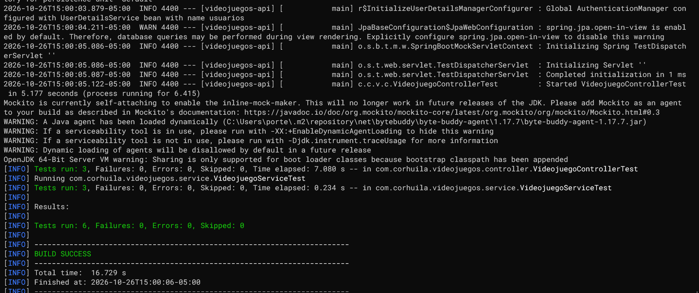
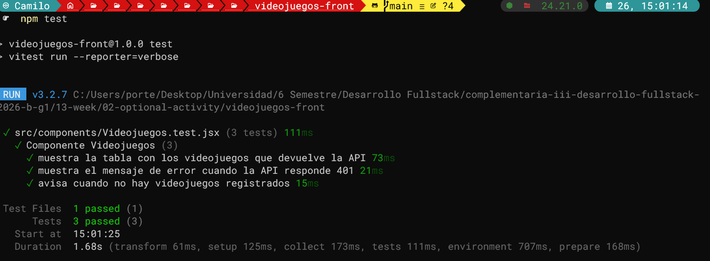

# Semana 13 · Pruebas de la aplicación — Catálogo de Videojuegos

| | |
| --- | --- |
| **Estudiante** | Juan Camilo Bernal Gordillo |
| **Materia** | Complementaria III - Profundización Desarrollo Fullstack (2026-B) |
| **Usuario de GitHub** | [JuanBernalCorhuila](https://github.com/JuanBernalCorhuila) |

Hasta ahora todo lo que comprobaba de mi catálogo de videojuegos lo comprobaba a mano: peticiones en Postman y clics en el navegador. Esta semana le escribí pruebas automáticas a las dos partes, para que con un solo comando se revise que todo sigue funcionando y no se rompa nada en silencio cuando cambie algo.

- En el **backend** hice una prueba **unitaria** del service (solo esa clase, aislada) y una prueba de **integración** de los endpoints (la petición pasa por la seguridad, el controller, el service, el repository y H2).
- En el **frontend** hice una prueba del **componente** `Videojuegos`, que es el que muestra el catálogo.

En las dos partes no me quedé solo con el camino feliz: también pruebo lo que pasa cuando algo sale mal (un id que no existe, una petición sin token, un error 401 en la pantalla y una lista vacía).

## 1. Estructura del proyecto

```
02-optional-activity/
├── README.md
├── evidencias/                                   (capturas de las pruebas)
├── videojuegos-api/                              (backend, el mismo de la semana 12)
│   ├── pom.xml                                   (cambió: dependencia de pruebas)
│   └── src/
│       ├── main/                                 (sin cambios)
│       └── test/java/com/corhuila/videojuegos/   (nuevo)
│           ├── service/VideojuegoServiceTest.java        (prueba unitaria)
│           └── controller/VideojuegoControllerTest.java  (prueba de integración)
└── videojuegos-front/                            (frontend, el mismo de la semana 12)
    ├── package.json                              (cambió: script "test" y librerías de pruebas)
    ├── vite.config.js                            (cambió: configuración de las pruebas)
    └── src/
        ├── setupTests.js                         (nuevo)
        └── components/
            ├── Videojuegos.jsx
            └── Videojuegos.test.jsx              (nuevo: prueba del componente)
```

No toqué el código de la aplicación: la entidad, las capas, los endpoints y los componentes son los mismos de la semana pasada. Solo agregué las pruebas y lo necesario para ejecutarlas. Las pruebas van en `src/test`, separadas del código de `src/main`, y Maven no las incluye en la aplicación que se ejecuta.

## 2. Pruebas del backend

En el `pom.xml` agregué `spring-boot-starter-test`, que trae JUnit 5 (para escribir las pruebas y los `assert...`), Mockito (para crear objetos falsos) y MockMvc (para hacer peticiones a los endpoints sin levantar el servidor). Tiene `scope test`, o sea que solo se usa al ejecutar las pruebas.

```xml
<dependency>
    <groupId>org.springframework.boot</groupId>
    <artifactId>spring-boot-starter-test</artifactId>
    <scope>test</scope>
</dependency>
```

A cada prueba le puse un nombre que dice qué hace y qué espera: `metodo_situacion_resultado`.

### Prueba unitaria del service (`VideojuegoServiceTest`)

Aquí pruebo solo `VideojuegoService`. El repositorio lo reemplazo por un *mock* (un repositorio falso de Mockito) y le digo qué tiene que responder. Así la prueba no depende de la base de datos y es muy rápida.

```java
@ExtendWith(MockitoExtension.class)
class VideojuegoServiceTest {

    @Mock
    private VideojuegoRepository repo;      // repositorio falso

    @InjectMocks
    private VideojuegoService service;      // el service real, usando el repositorio falso
```

El camino feliz es actualizar un videojuego que sí existe: le paso los datos nuevos y compruebo que quedaron copiados y que se llamó a `save`.

```java
@Test
void actualizar_idExistente_copiaLosDatosYGuarda() {
    Videojuego actual = new Videojuego("Forza Horizon 5", "Carreras", "Xbox Series X", 189900, 2021);
    Videojuego nuevos = new Videojuego("Forza Horizon 5", "Carreras", "PC", 159900, 2021);
    when(repo.findById(2L)).thenReturn(Optional.of(actual));
    when(repo.save(actual)).thenReturn(actual);

    Optional<Videojuego> resultado = service.actualizar(2L, nuevos);

    assertTrue(resultado.isPresent());
    assertEquals("PC", resultado.get().getPlataforma());
    assertEquals(159900.0, resultado.get().getPrecio());
    verify(repo).save(actual);
}
```

Los casos de error son los ids que no existen. Al actualizar el `99`, el service debe devolver vacío (que el controller convierte en `404`) y no guardar nada; al borrar el `99`, debe devolver `false` sin llamar a `deleteById`.

```java
@Test
void actualizar_idInexistente_devuelveVacioYNoGuarda() {
    when(repo.findById(99L)).thenReturn(Optional.empty());

    Optional<Videojuego> resultado = service.actualizar(99L, new Videojuego());

    assertTrue(resultado.isEmpty());
    verify(repo, never()).save(any());
}
```

### Prueba de integración de los endpoints (`VideojuegoControllerTest`)

Aquí no hay nada falso. `@SpringBootTest` levanta la aplicación completa, con la seguridad JWT y la base H2, y `MockMvc` hace las peticiones HTTP como si fuera Postman, pero sin abrir el puerto 8080.

Como los endpoints del catálogo están protegidos, antes de cada prueba hago un login de verdad con `admin` / `admin123` y guardo el token que devuelve la API:

```java
@BeforeEach
void obtenerToken() throws Exception {
    String respuesta = mockMvc.perform(post("/api/auth/login")
                    .contentType(MediaType.APPLICATION_JSON)
                    .content("{\"usuario\":\"admin\",\"clave\":\"admin123\"}"))
            .andExpect(status().isOk())
            .andReturn().getResponse().getContentAsString();
    token = JsonPath.read(respuesta, "$.token");
}
```

El camino feliz es listar con el token: debe responder `200` con los dos videojuegos que la aplicación carga al arrancar.

```java
@Test
void listar_conToken_responde200ConLosDosVideojuegos() throws Exception {
    mockMvc.perform(get("/api/videojuegos").header("Authorization", "Bearer " + token))
            .andExpect(status().isOk())
            .andExpect(jsonPath("$.length()").value(2))
            .andExpect(jsonPath("$[0].titulo").value("Red Dead Redemption 2"))
            .andExpect(jsonPath("$[1].titulo").value("Forza Horizon 5"));
}
```

Y los casos de error: pedir un id que no existe debe dar `404`, y pedir el listado sin token debe dar `401`, porque la seguridad no lo deja pasar.

```java
@Test
void buscar_idInexistente_responde404() throws Exception {
    mockMvc.perform(get("/api/videojuegos/99").header("Authorization", "Bearer " + token))
            .andExpect(status().isNotFound());
}

@Test
void listar_sinToken_responde401() throws Exception {
    mockMvc.perform(get("/api/videojuegos"))
            .andExpect(status().isUnauthorized());
}
```

La diferencia entre las dos clases es justo la diferencia entre unitaria e integración: la primera prueba una sola pieza con todo lo demás simulado, y la segunda prueba que todas las capas funcionen juntas.

## 3. Prueba del frontend

Para el frontend usé **Vitest**, que funciona con la misma configuración de Vite que ya tenía, junto con **React Testing Library**, que dibuja el componente y permite buscar textos en la pantalla como lo haría un usuario. Las librerías que agregué en `package.json` (todas como dependencias de desarrollo) son:

- `vitest`: ejecuta las pruebas.
- `jsdom`: simula el navegador dentro de Node, porque las pruebas no abren un navegador de verdad.
- `@testing-library/react` y `@testing-library/dom`: dibujan el componente y buscan elementos en la pantalla.
- `@testing-library/jest-dom`: agrega comprobaciones como `toBeInTheDocument()`.

También agregué el script `"test": "vitest run --reporter=verbose"`, que ejecuta las pruebas una vez, termina y muestra el nombre de cada prueba con su resultado.

En `vite.config.js` le indiqué a Vitest que use `jsdom` y que cargue `setupTests.js` antes de las pruebas:

```js
test: {
  environment: "jsdom",
  globals: true,
  setupFiles: "./src/setupTests.js",
},
```

### Prueba del componente `Videojuegos` (`Videojuegos.test.jsx`)

El componente pide los datos con `getVideojuegos` de `api.js`. En la prueba reemplazo `api.js` por una versión falsa con `vi.mock`, así no necesito tener el backend encendido y en cada caso decido qué "responde" la API. Si la prueba dependiera de la API real, fallaría cada vez que el backend estuviera apagado o cambiaran los datos.

```jsx
vi.mock("../api.js");
```

El camino feliz: mientras llega la respuesta se debe ver "Cargando videojuegos..." y después la tabla con los dos videojuegos.

```jsx
test("muestra la tabla con los videojuegos que devuelve la API", async () => {
  getVideojuegos.mockResolvedValue([
    { id: 1, titulo: "Red Dead Redemption 2", genero: "Aventura", plataforma: "PS4", precio: 149900, anioLanzamiento: 2018 },
    { id: 2, titulo: "Forza Horizon 5", genero: "Carreras", plataforma: "Xbox Series X", precio: 189900, anioLanzamiento: 2021 },
  ]);

  render(<Videojuegos onCerrarSesion={() => {}} />);

  expect(screen.getByText("Cargando videojuegos...")).toBeInTheDocument();
  expect(await screen.findByText("Red Dead Redemption 2")).toBeInTheDocument();
  expect(screen.getByText("Forza Horizon 5")).toBeInTheDocument();
  expect(screen.queryByText("Cargando videojuegos...")).not.toBeInTheDocument();
});
```

`findByText` espera a que el texto aparezca, porque los datos llegan después de dibujar el componente.

El caso de error: hago que la API falle con el mensaje de sesión no válida (`401`) y compruebo que se muestre ese mensaje y que no aparezca la tabla.

```jsx
test("muestra el mensaje de error cuando la API responde 401", async () => {
  getVideojuegos.mockRejectedValue(
    new Error("Tu sesión no es válida o ya venció (401). Inicia sesión de nuevo.")
  );

  render(<Videojuegos onCerrarSesion={() => {}} />);

  expect(await screen.findByText(/no es válida o ya venció/)).toBeInTheDocument();
  expect(screen.queryByRole("table")).not.toBeInTheDocument();
});
```

Y el caso límite: si la API responde una lista vacía, se debe ver "No hay videojuegos registrados." en lugar de una tabla vacía.

## 4. Cómo ejecutar las pruebas

Se necesitan Java 17 o superior, Maven y Node.js (versión 20.19 o superior). Para las pruebas no hace falta tener la API ni el frontend encendidos.

**Backend**, desde la carpeta `videojuegos-api`:

```bash
mvn test
```

**Frontend**, desde la carpeta `videojuegos-front` (el `npm install` solo hace falta la primera vez):

```bash
npm install
npm test
```

La aplicación se sigue ejecutando igual que la semana pasada (`mvn spring-boot:run` y `npm run dev`).

## 5. Resultados

**1. Pruebas del backend** — Al ejecutar `mvn test` corren las 6 pruebas: 3 de `VideojuegoServiceTest` y 3 de `VideojuegoControllerTest`. Todas pasan (`Tests run: 6, Failures: 0, Errors: 0`) y termina en `BUILD SUCCESS`.



**2. Pruebas del frontend** — Al ejecutar `npm test` corren las 3 pruebas de `Videojuegos.test.jsx`, cada una con su nombre: la del listado, la del error 401 y la de la lista vacía. Pasan todas (`Tests 3 passed (3)`).



Ahora, antes de subir un cambio, con `mvn test` y `npm test` sé en pocos segundos si el catálogo sigue funcionando, tanto cuando todo sale bien como cuando algo falla.
