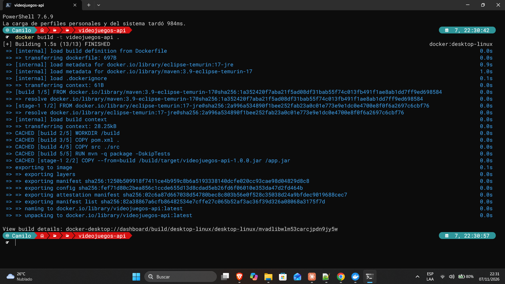
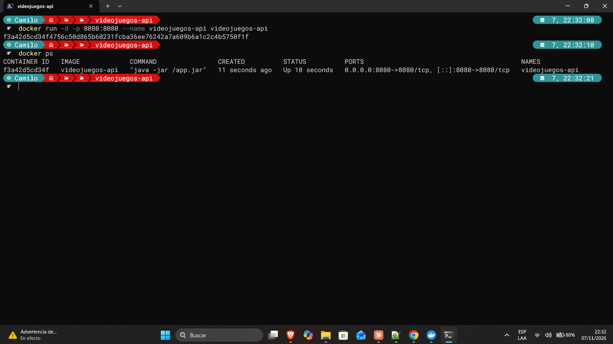
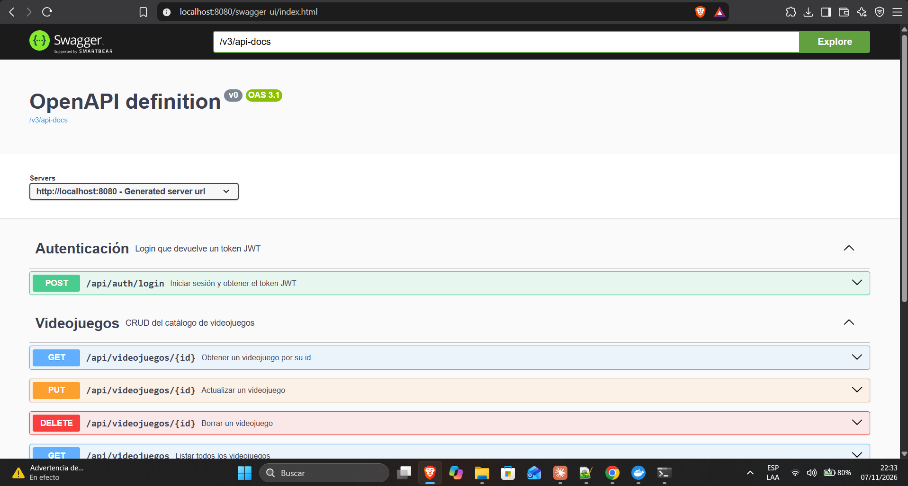
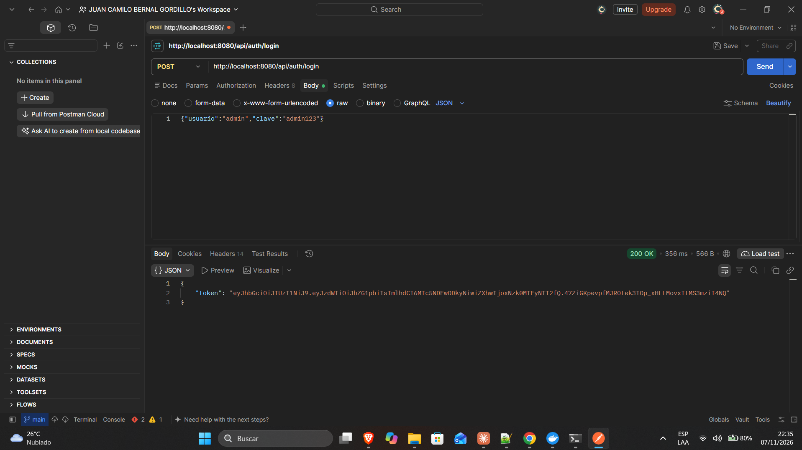
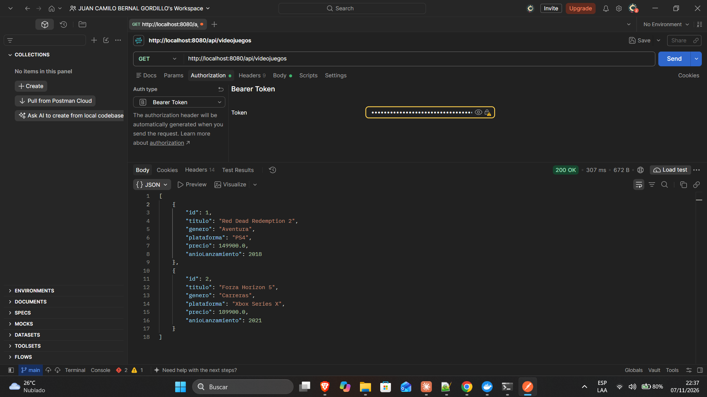

# Semana 14 · Contenerizar con Docker — Catálogo de Videojuegos

| | |
| --- | --- |
| **Estudiante** | Juan Camilo Bernal Gordillo |
| **Materia** | Complementaria III - Profundización Desarrollo Fullstack (2026-B) |
| **Usuario de GitHub** | [JuanBernalCorhuila](https://github.com/JuanBernalCorhuila) |

Esta semana empaqueté el backend de mi catálogo de videojuegos en un contenedor con Docker. Escribí un `Dockerfile`, con él construí la imagen (`docker build`), corrí el contenedor publicando el puerto (`docker run -p`) y comprobé que la API responde desde el contenedor.

Con esto la API ya no depende de que el computador tenga Java ni Maven instalados: para correrla solo se necesita Docker. El código de la API es el mismo de las semanas anteriores (entity, repository, service y controller, con el login JWT de la semana 11); no cambié nada de él, solo le agregué el `Dockerfile` y el `.dockerignore`.

```
Dockerfile  --docker build-->  Imagen  --docker run -p-->  Contenedor (API en el puerto 8080)
 (receta)                    (plantilla)                    (instancia en ejecución)
```

## 1. Estructura del proyecto

```
actividad-semana-14/
├── README.md
├── evidencias/                                   (capturas de la construcción, la ejecución y la verificación)
└── videojuegos-api/                              (backend)
    ├── Dockerfile                                (nuevo)
    ├── .dockerignore                             (nuevo)
    ├── .gitignore
    ├── pom.xml
    └── src/
        ├── main/
        │   ├── java/com/corhuila/videojuegos/
        │   │   ├── VideojuegosApiApplication.java
        │   │   ├── model/Videojuego.java
        │   │   ├── repository/VideojuegoRepository.java
        │   │   ├── service/VideojuegoService.java
        │   │   ├── controller/
        │   │   │   ├── VideojuegoController.java
        │   │   │   └── AuthController.java
        │   │   ├── dto/
        │   │   │   ├── LoginRequest.java
        │   │   │   └── LoginResponse.java
        │   │   └── security/
        │   │       ├── JwtService.java
        │   │       ├── JwtFilter.java
        │   │       └── SecurityConfig.java
        │   └── resources/application.properties
        └── test/java/com/corhuila/videojuegos/   (pruebas de semanas anteriores)
```

Esta carpeta se puede usar sola: tiene el proyecto completo y no depende de ninguna otra carpeta del repositorio.

## 2. Imagen y contenedor

Lo que más me ayudó a entender Docker fue separar estas dos cosas:

- La **imagen** es la plantilla: mi API ya compilada junto con el Java que necesita para correr, todo "congelado". No se ejecuta por sí sola.
- El **contenedor** es una instancia en funcionamiento de esa imagen. De una misma imagen puedo correr varios contenedores.

El `Dockerfile` es la receta con la que se construye la imagen. Con la imagen construida, "correr la API" es crear un contenedor a partir de ella.

## 3. El Dockerfile

```dockerfile
# ---------- Etapa 1: compilar el proyecto y generar el .jar ----------
FROM maven:3.9-eclipse-temurin-17 AS build
WORKDIR /build
COPY pom.xml .
COPY src ./src
RUN mvn -q package -DskipTests

# ---------- Etapa 2: imagen final, solo con lo necesario para ejecutar ----------
FROM eclipse-temurin:17-jre
COPY --from=build /build/target/videojuegos-api-1.0.0.jar /app.jar
EXPOSE 8080
ENTRYPOINT ["java", "-jar", "/app.jar"]
```

Lo escribí en dos etapas:

- **Etapa 1 (`build`).** Parto de una imagen que trae Maven y el JDK 17 (la misma versión de Java de mi proyecto). Copio el `pom.xml` y el código, y con `mvn package` se genera el `.jar` de la API. Así no necesito tener Maven instalado para construir la imagen. Uso `-DskipTests` porque las pruebas ya las ejecuto aparte con `mvn test`.
- **Etapa 2.** Parto de una imagen que solo trae el JRE (el entorno para ejecutar Java, sin Maven ni el código fuente) y copio únicamente el `.jar` que salió de la primera etapa. Por eso la imagen final queda más liviana: solo lleva lo necesario para correr.

Y las últimas dos líneas:

- `EXPOSE 8080` indica que la API escucha en el puerto 8080. Por sí sola no abre el puerto hacia mi computador; eso se hace al correr el contenedor con `-p`.
- `ENTRYPOINT` es el comando que se ejecuta al iniciar el contenedor: `java -jar /app.jar`.

También agregué un `.dockerignore`, que le dice a Docker qué no copiar al construir la imagen (la carpeta `target/` que genera Maven, `.git` y `.vscode`), para que la construcción sea más rápida y limpia:

```
target/
.git
.vscode
```

## 4. Construir la imagen y correr el contenedor

Con Docker Desktop abierto, desde la carpeta `videojuegos-api`:

**Construir la imagen:**

```bash
docker build -t videojuegos-api .
```

`-t videojuegos-api` es el nombre que le doy a la imagen, y el `.` final le dice a Docker que el `Dockerfile` está en la carpeta actual. La primera vez tarda un poco porque descarga las imágenes base y las dependencias de Maven.

**Correr el contenedor:**

```bash
docker run -d -p 8080:8080 --name videojuegos-api videojuegos-api
```

- `-p 8080:8080` publica el puerto: el primero es el del computador y el segundo el del contenedor. Sin esto la API estaría corriendo pero no podría llegar a ella desde mi computador.
- `-d` deja el contenedor en segundo plano, para no ocupar la terminal.
- `--name videojuegos-api` le pone nombre al contenedor para encontrarlo fácil.
- El último `videojuegos-api` es la imagen a partir de la cual se crea.

Para ver que quedó corriendo y qué dice la aplicación:

```bash
docker ps
docker logs videojuegos-api
```

Y para detenerlo y borrarlo cuando termine:

```bash
docker stop videojuegos-api
docker rm videojuegos-api
```

La base de datos H2 está en memoria dentro del contenedor, así que cada vez que lo creo de nuevo arranca solo con los dos videojuegos iniciales (Red Dead Redemption 2 y Forza Horizon 5).

## 5. Verificar que la API responde desde el contenedor

Para comprobar que la app responde de verdad, la consulto desde fuera del contenedor, por el puerto que publiqué (`8080`):

1. **La documentación.** `http://localhost:8080/swagger-ui.html` es una ruta pública, así que si la página carga es porque la API está arriba y respondiendo.
2. **El login.** Los endpoints del catálogo están protegidos con JWT, entonces primero pido el token con `POST http://localhost:8080/api/auth/login` y el cuerpo `{"usuario":"admin","clave":"admin123"}`. Responde `200 OK` con el token.
3. **El catálogo.** Con ese token en la cabecera `Authorization: Bearer <token>`, `GET http://localhost:8080/api/videojuegos` responde `200 OK` con los dos videojuegos que carga la aplicación al arrancar.

Así verifico que no solo el contenedor está encendido, sino que la aplicación funciona completa por dentro: la seguridad, la capa de datos y los endpoints.

## 6. Cómo ejecutarlo

Solo hace falta tener Docker Desktop abierto. Desde la carpeta `videojuegos-api`:

```bash
docker build -t videojuegos-api .
docker run -d -p 8080:8080 --name videojuegos-api videojuegos-api
```

Y luego abrir `http://localhost:8080/swagger-ui.html`. Si prefiero ver los mensajes de la aplicación en la terminal en lugar de dejarla en segundo plano, quito el `-d` (y la detengo con `Ctrl + C`).

## 7. Evidencias

**1. Construcción de la imagen** — Con `docker build -t videojuegos-api .` se construye la imagen a partir del `Dockerfile`, sin errores, y queda con el nombre `videojuegos-api`.



**2. Contenedor corriendo** — Con `docker run -d -p 8080:8080 --name videojuegos-api videojuegos-api` creo el contenedor y con `docker ps` compruebo que está en ejecución (`Up`) y que el puerto `8080` del computador está conectado al `8080` del contenedor.



**3. La API responde: Swagger** — Desde el navegador, `http://localhost:8080/swagger-ui.html` carga la documentación de la API que está corriendo dentro del contenedor.



**4. La API responde: login** — En Postman, `POST http://localhost:8080/api/auth/login` con `admin` / `admin123` responde `200 OK` con el token.



**5. La API responde: catálogo** — Con el token en `Authorization: Bearer`, `GET http://localhost:8080/api/videojuegos` responde `200 OK` con Red Dead Redemption 2 y Forza Horizon 5.



Con esto quedó la API de videojuegos empaquetada en una imagen, corriendo en un contenedor y respondiendo desde mi computador, sin necesidad de instalar Java ni Maven para ejecutarla.
