# Actividad calificable · Corte 3 — App fullstack segura y probada

| | |
| --- | --- |
| **Estudiante** | Juan Camilo Bernal Gordillo |
| **Materia** | Complementaria III - Profundización Desarrollo Fullstack (2026-B) |
| **Usuario de GitHub** | [JuanBernalCorhuila](https://github.com/JuanBernalCorhuila) |

Para este corte dejé mi catálogo de videojuegos como una aplicación fullstack completa: un backend en Spring Boot y un frontend en React que se hablan entre sí de forma segura, con pruebas automáticas y empaquetada en contenedores con Docker.

- **Seguridad con JWT:** para ver o modificar el catálogo primero hay que iniciar sesión. El login devuelve un token y la API solo atiende los endpoints protegidos si ese token viene en la petición.
- **Frontend conectado:** en React hice una pantalla de login y una vista con la tabla de videojuegos. Como el frontend y la API están en orígenes distintos, habilité CORS en el backend.
- **Pruebas:** escribí pruebas para el backend y para el frontend, y en las dos incluí casos de error.
- **Docker:** le escribí un `Dockerfile` al backend y otro al frontend, y un `docker-compose.yml` para levantar los dos con un solo comando.

Esta carpeta junta lo que fui construyendo en las semanas 11 (JWT), 12 (frontend y CORS) y 13 (pruebas). No cambié la entidad, las capas ni los endpoints de mi API de videojuegos: lo copié aquí para que la entrega se pueda ejecutar sola, sin depender de otras carpetas. Lo nuevo de este corte es todo lo de Docker.

```
[ Navegador: React (localhost:5173) ]                    [ API Spring Boot (localhost:8080) ]
        │                                                          │
        ├── POST /api/auth/login  { usuario, clave } ─────────────►│ valida usuario y clave
        │◄──────────────── 200 { "token": "..." }  (o 401) ────────┤
        │ guarda el token                                          │
        │                                                          │
        └── GET /api/videojuegos                                   │
            Authorization: Bearer <token> ────────────────────────►│ JwtFilter valida el token ──► H2
            ◄──────────────── 200 JSON ──► tabla  (o 401) ─────────┘
```

## 1. Estructura del proyecto

```
c3-activity/
├── README.md
├── docker-compose.yml                       (nuevo: levanta backend y frontend juntos)
├── evidencias/                              (capturas de las pruebas y de la ejecución)
├── videojuegos-api/                         (backend)
│   ├── Dockerfile                           (nuevo)
│   ├── .dockerignore                        (nuevo)
│   ├── pom.xml
│   └── src/
│       ├── main/
│       │   ├── java/com/corhuila/videojuegos/
│       │   │   ├── VideojuegosApiApplication.java    (arranque y datos iniciales)
│       │   │   ├── model/Videojuego.java             (entity)
│       │   │   ├── repository/VideojuegoRepository.java
│       │   │   ├── service/VideojuegoService.java
│       │   │   ├── controller/
│       │   │   │   ├── VideojuegoController.java     (CRUD del catálogo, con CORS)
│       │   │   │   └── AuthController.java           (login, con CORS)
│       │   │   ├── dto/
│       │   │   │   ├── LoginRequest.java
│       │   │   │   └── LoginResponse.java
│       │   │   └── security/
│       │   │       ├── JwtService.java               (crea y valida tokens)
│       │   │       ├── JwtFilter.java                (revisa el token en cada petición)
│       │   │       └── SecurityConfig.java           (qué es público y qué no, CORS)
│       │   └── resources/application.properties
│       └── test/java/com/corhuila/videojuegos/
│           ├── service/VideojuegoServiceTest.java        (prueba unitaria)
│           └── controller/VideojuegoControllerTest.java  (prueba de integración)
└── videojuegos-front/                       (frontend en React con Vite)
    ├── Dockerfile                           (nuevo)
    ├── .dockerignore                        (nuevo)
    ├── package.json
    ├── vite.config.js
    ├── index.html
    └── src/
        ├── main.jsx                         (arranca React)
        ├── App.jsx                          (muestra el login o el catálogo)
        ├── App.css                          (estilos)
        ├── api.js                           (todas las llamadas a la API)
        ├── setupTests.js
        └── components/
            ├── Login.jsx                    (formulario de login)
            ├── Videojuegos.jsx              (tabla del catálogo)
            └── Videojuegos.test.jsx         (prueba del componente)
```

## 2. Seguridad con JWT (backend)

Un JWT es un texto que la API genera y firma con una clave secreta que solo ella conoce. Lleva dentro el nombre del usuario y una fecha de vencimiento. Como la firma no se puede falsificar sin la clave, la API puede confiar en un token que ella misma firmó, sin guardar sesiones en el servidor.

Para esto agregué al `pom.xml` `spring-boot-starter-security` (Spring Security) y `jjwt` (la librería que crea y valida los tokens), y la clave secreta y la duración del token las dejé en `application.properties`:

```properties
jwt.secret=clave-secreta-videojuegos-api-corhuila-2026
jwt.expiracion-ms=3600000
```

El token dura una hora (`3600000` milisegundos).

### El login: `AuthController`

`POST /api/auth/login` recibe el usuario y la clave. Si son correctos responde `200` con el token; si no, responde `401`. El usuario de prueba es `admin` / `admin123`: lo dejé en memoria en `SecurityConfig` y su clave se guarda cifrada con BCrypt, nunca en texto plano.

```java
@PostMapping("/login")
public ResponseEntity<LoginResponse> login(@RequestBody LoginRequest datos) {
    try {
        authenticationManager.authenticate(
                new UsernamePasswordAuthenticationToken(datos.usuario(), datos.clave()));
    } catch (AuthenticationException e) {
        return ResponseEntity.status(HttpStatus.UNAUTHORIZED).build();
    }
    return ResponseEntity.ok(new LoginResponse(jwtService.generarToken(datos.usuario())));
}
```

### Crear y validar el token: `JwtService`

`generarToken` crea el token con el usuario, la fecha de creación y la de vencimiento, y lo firma. `obtenerUsuario` hace el camino contrario: revisa la firma y que no haya vencido, y devuelve el usuario. Si el token es falso o ya venció, lanza una excepción.

```java
public String generarToken(String usuario) {
    Date ahora = new Date();
    return Jwts.builder()
            .subject(usuario)
            .issuedAt(ahora)
            .expiration(new Date(ahora.getTime() + expiracionMs))
            .signWith(clave)
            .compact();
}
```

### Revisar el token en cada petición: `JwtFilter`

Es un filtro que se ejecuta antes de llegar a los controladores. Si la petición trae la cabecera `Authorization: Bearer <token>` y el token es válido, marca la petición como autenticada. Si el token no viene, es falso o venció, no la marca, y Spring Security responde `401`.

```java
String header = request.getHeader("Authorization");

if (header != null && header.startsWith("Bearer ")) {
    String token = header.substring(7);
    try {
        String usuario = jwtService.obtenerUsuario(token);
        var auth = new UsernamePasswordAuthenticationToken(usuario, null, List.of());
        SecurityContextHolder.getContext().setAuthentication(auth);
    } catch (JwtException | IllegalArgumentException e) {
        // Token inválido o vencido: la petición sigue sin autenticar
    }
}
chain.doFilter(request, response);
```

### Qué es público y qué está protegido: `SecurityConfig`

Aquí decidí qué rutas se pueden usar sin token y cuáles no. Como la API no usa formularios ni cookies, desactivé CSRF y la sesión (cada petición se identifica solo con su token).

```java
.authorizeHttpRequests(auth -> auth
        .requestMatchers("/api/auth/login").permitAll()
        .requestMatchers("/swagger-ui.html", "/swagger-ui/**", "/v3/api-docs/**").permitAll()
        .requestMatchers("/error").permitAll()
        .anyRequest().authenticated())
.exceptionHandling(e -> e.authenticationEntryPoint(new HttpStatusEntryPoint(HttpStatus.UNAUTHORIZED)))
.addFilterBefore(new JwtFilter(jwtService), UsernamePasswordAuthenticationFilter.class);
```

| Endpoint | ¿Pide token? | Respuestas |
| --- | --- | --- |
| `POST /api/auth/login` | No | `200` con el token, `401` si el usuario o la clave no coinciden |
| `GET /api/videojuegos` y `GET /api/videojuegos/{id}` | Sí | `200`, o `404` si el id no existe |
| `POST`, `PUT` y `DELETE` en `/api/videojuegos` | Sí | `201`, `200` y `204`, o `404` si el id no existe |
| Cualquier endpoint protegido sin token, o con un token falso o vencido | — | `401` |
| `/swagger-ui.html` (documentación) | No | La página de Swagger |

## 3. Frontend: login y vista con datos

El frontend es una aplicación en React (con Vite). Separé las llamadas a la API (`api.js`) de los componentes que pintan la pantalla.

- **`App.jsx`** decide qué mostrar: si hay un token guardado en `localStorage` muestra el catálogo; si no, el login.
- **`Login.jsx`** es el formulario de usuario y clave. Mientras espera la respuesta deshabilita el botón y, si el login falla, muestra el error.
- **`Videojuegos.jsx`** es la vista con datos: pide los videojuegos a la API y los muestra en una tabla. Mientras llegan se ve "Cargando videojuegos..." y, si algo falla, un mensaje de error en lugar de una pantalla en blanco. Tiene un botón para cerrar sesión, que borra el token.
- **`api.js`** guarda la dirección de la API en un solo lugar y tiene las dos llamadas.

Al hacer login, `api.js` guarda el token en `localStorage`. En la petición protegida lo lee y lo envía en la cabecera `Authorization`:

```js
export async function getVideojuegos() {
  const token = localStorage.getItem("token");
  const res = await pedir(`${API_URL}/videojuegos`, {
    headers: { Authorization: `Bearer ${token}` },
  });
  if (res.status === 401) throw new Error("Tu sesión no es válida o ya venció (401). Inicia sesión de nuevo.");
  if (!res.ok) throw new Error("Error " + res.status);
  return res.json();
}
```

Así, si el token venció o no es válido, el usuario ve un mensaje claro y puede volver a iniciar sesión con el botón "Cerrar sesión".

## 4. CORS: que el navegador deje hablar al frontend con la API

CORS es una protección del navegador: si una página de un origen (`http://localhost:5173`, el frontend) llama a una API de otro origen (`http://localhost:8080`), el navegador bloquea la respuesta a menos que la API diga que ese origen está permitido. Postman no es un navegador y por eso no tiene este problema.

Lo resolví en dos pasos. Primero, les puse `@CrossOrigin` a los dos controladores, porque el frontend usa los dos (login y catálogo):

```java
@CrossOrigin(origins = "http://localhost:5173")
@RestController
@RequestMapping("/api/videojuegos")
public class VideojuegoController { /* ... */ }
```

Segundo, activé CORS dentro de la cadena de seguridad. Cuando el navegador va a enviar una petición con la cabecera `Authorization`, antes manda una petición previa de tipo `OPTIONS` (el *preflight*) para preguntar si está permitido, y esa petición nunca lleva token. Sin esta línea, la seguridad la rechazaría con `401` y el navegador cancelaría la petición real:

```java
http
        .cors(Customizer.withDefaults())
        .csrf(csrf -> csrf.disable())
```

Por esto el frontend tiene fijo el puerto `5173` (`vite.config.js`) y, en Docker, lo publico en ese mismo puerto: es el único origen que la API tiene permitido.

## 5. Pruebas

Escribí pruebas para las dos partes y en las dos probé también lo que pasa cuando algo sale mal, no solo el camino feliz.

### Backend (6 pruebas, con JUnit 5, Mockito y MockMvc)

| Prueba | Qué comprueba | Tipo |
| --- | --- | --- |
| `VideojuegoServiceTest.actualizar_idExistente_copiaLosDatosYGuarda` | Actualizar un videojuego que existe copia los datos y guarda | Camino feliz |
| `VideojuegoServiceTest.actualizar_idInexistente_devuelveVacioYNoGuarda` | Con un id que no existe devuelve vacío y no guarda nada | **Error** |
| `VideojuegoServiceTest.eliminar_idInexistente_devuelveFalseYNoBorra` | Borrar un id que no existe devuelve `false` y no borra | **Error** |
| `VideojuegoControllerTest.listar_conToken_responde200ConLosDosVideojuegos` | Con un token válido el listado responde `200` con los dos videojuegos | Camino feliz |
| `VideojuegoControllerTest.buscar_idInexistente_responde404` | Pedir el id `99` responde `404` | **Error** |
| `VideojuegoControllerTest.listar_sinToken_responde401` | Sin token la seguridad responde `401` | **Error** |

Las tres primeras son pruebas **unitarias**: solo prueban el service y el repositorio es un *mock* (un falso de Mockito), sin base de datos. Las otras tres son de **integración**: `@SpringBootTest` levanta toda la aplicación (seguridad, controller, service, repository y H2) y `MockMvc` hace las peticiones HTTP sin abrir el puerto. Antes de cada una hago un login real con `admin` / `admin123` para obtener un token válido:

```java
@BeforeEach
void obtenerToken() throws Exception {
    String respuesta = mockMvc.perform(post("/api/auth/login")
                    .contentType(MediaType.APPLICATION_JSON)
                    .content("{\"usuario\":\"admin\",\"clave\":\"admin123\"}"))
            .andExpect(status().isOk())
            .andReturn().getResponse().getContentAsString();
    token = JsonPath.read(respuesta, "$.token");
}
```

El caso de error que prueba la seguridad es el de la petición sin token:

```java
@Test
void listar_sinToken_responde401() throws Exception {
    mockMvc.perform(get("/api/videojuegos"))
            .andExpect(status().isUnauthorized());
}
```

### Frontend (3 pruebas, con Vitest y React Testing Library)

Pruebo el componente `Videojuegos`. En la prueba reemplazo `api.js` por una versión falsa (`vi.mock`), así no necesito el backend encendido y en cada caso decido qué "responde" la API.

| Prueba | Qué comprueba | Tipo |
| --- | --- | --- |
| `muestra la tabla con los videojuegos que devuelve la API` | Se ve "Cargando videojuegos..." y después la tabla con los datos | Camino feliz |
| `muestra el mensaje de error cuando la API responde 401` | Se ve el mensaje de sesión no válida y no aparece la tabla | **Error** |
| `avisa cuando no hay videojuegos registrados` | Con una lista vacía se ve "No hay videojuegos registrados." | Caso límite |

```jsx
test("muestra el mensaje de error cuando la API responde 401", async () => {
  getVideojuegos.mockRejectedValue(
    new Error("Tu sesión no es válida o ya venció (401). Inicia sesión de nuevo.")
  );

  render(<Videojuegos onCerrarSesion={() => {}} />);

  expect(await screen.findByText(/no es válida o ya venció/)).toBeInTheDocument();
  expect(screen.queryByRole("table")).not.toBeInTheDocument();
});
```

## 6. Docker

Con Docker empaqueto cada parte de la aplicación junto con lo que necesita para correr (Java, Node, nginx), así funciona igual en cualquier computador y para ejecutarla solo necesito tener Docker, sin instalar Java ni Node a mano. Lo que escribo en el `Dockerfile` es la receta; con ella se construye una **imagen**, que es la plantilla de la aplicación ya empaquetada; y al ejecutar la imagen se crea un **contenedor**, que es una instancia en funcionamiento de esa imagen.

### Backend: `videojuegos-api/Dockerfile`

```dockerfile
# ---------- Etapa 1: compilar el proyecto y generar el .jar ----------
FROM maven:3.9-eclipse-temurin-17 AS build
WORKDIR /build
COPY pom.xml .
COPY src ./src
RUN mvn -q package -DskipTests

# ---------- Etapa 2: imagen final, solo con lo necesario para ejecutar ----------
FROM eclipse-temurin:17-jre
COPY --from=build /build/target/videojuegos-api-1.0.0.jar /app.jar
EXPOSE 8080
ENTRYPOINT ["java", "-jar", "/app.jar"]
```

Lo hice en dos etapas. En la primera uso una imagen que trae Maven y el JDK 17 (la misma versión de Java de mi proyecto) para compilar y generar el `.jar`; así no necesito tener Maven instalado para construir la imagen. En la segunda parto de una imagen que solo trae el JRE (el entorno para ejecutar Java, sin Maven ni el código fuente) y copio únicamente el `.jar`: la imagen final queda mucho más liviana. `EXPOSE 8080` indica el puerto de la API y `ENTRYPOINT` es el comando que se ejecuta al iniciar el contenedor. Las pruebas no se corren dentro de la imagen (`-DskipTests`) porque ya las ejecuto con `mvn test`. El `.dockerignore` evita copiar la carpeta `target/` a la imagen.

### Frontend: `videojuegos-front/Dockerfile`

```dockerfile
# ---------- Etapa 1: construir la aplicacion de React ----------
FROM node:22-alpine AS build
WORKDIR /build
COPY package.json .
RUN npm install
COPY . .
RUN npm run build

# ---------- Etapa 2: servir esos archivos con nginx ----------
FROM nginx:alpine
COPY --from=build /build/dist /usr/share/nginx/html
EXPOSE 80
```

Es la misma idea: en la primera etapa `npm run build` convierte el proyecto de React en archivos estáticos (la carpeta `dist`), y en la segunda un servidor nginx los entrega, sin necesidad de Node en la imagen final.

### Los dos juntos: `docker-compose.yml`

```yaml
services:
  api:
    build: ./videojuegos-api
    image: videojuegos-api
    container_name: videojuegos-api
    ports:
      - "8080:8080"

  front:
    build: ./videojuegos-front
    image: videojuegos-front
    container_name: videojuegos-front
    ports:
      - "5173:80"
    depends_on:
      - api
```

Cada servicio construye su imagen a partir de su carpeta y publica su puerto (`-p` en `docker run`): el formato es `puerto del computador:puerto del contenedor`. Al frontend lo publico en el `5173` (el contenedor usa el 80 por dentro) porque ese es el origen que la API permite en CORS.

El archivo de Compose no es obligatorio, pero con él levanto backend y frontend con un solo comando en lugar de construir y ejecutar cada contenedor por separado. Es equivalente a hacer a mano `docker build -t videojuegos-api ./videojuegos-api` y `docker run -p 8080:8080 videojuegos-api`, y lo mismo con el frontend.

La base de datos H2 está en memoria, dentro del contenedor de la API, así que cada vez que lo detengo los datos vuelven a ser los dos videojuegos iniciales. Por eso no necesité un volumen; si guardara datos que deben conservarse, ahí sí tendría que usar uno.

## 7. Cómo ejecutarlo

### Con Docker (solo necesito Docker Desktop abierto)

Desde la carpeta `c3-activity`:

```bash
docker compose up --build
```

La primera vez tarda porque descarga las imágenes base y las dependencias. La terminal se queda mostrando los registros de los contenedores; cuando aparece que la API arrancó (`Started VideojuegosApiApplication`), ya puedo entrar a:

- Frontend: http://localhost:5173 (inicio sesión con `admin` / `admin123`)
- API: http://localhost:8080 (documentación en http://localhost:8080/swagger-ui.html)

Hay que entrar por `localhost` y no por `127.0.0.1`, porque CORS solo permite el origen `http://localhost:5173`.

Si prefiero dejar los contenedores corriendo en segundo plano, sin ocupar la terminal, uso `docker compose up -d` y los listo con `docker ps`. Para detener todo:

```bash
docker compose down
```

### Sin Docker

Necesito Java 17 o superior, Maven y Node.js 20.19 o superior.

```bash
# Backend (desde videojuegos-api)
mvn spring-boot:run

# Frontend (desde videojuegos-front, en otra terminal)
npm install
npm run dev
```

### Pruebas

No hace falta tener la API ni el frontend encendidos.

```bash
# Backend (desde videojuegos-api)
mvn test

# Frontend (desde videojuegos-front)
npm install
npm test
```

## 8. Security & run

The API is secured with JWT (JSON Web Token). A client sends a POST request to `/api/auth/login` with a username and a password (`admin` / `admin123`), and if they are correct the API answers `200` with a signed token that expires after one hour; if not, it answers `401`. The React frontend saves that token in `localStorage` and sends it in the `Authorization: Bearer <token>` header of every request to `/api/videojuegos`. A `JwtFilter` checks the signature and the expiration date of the token on each request, so a missing, fake or expired token gets a `401 Unauthorized`, while only the login and the Swagger documentation are public. Because the frontend (`localhost:5173`) and the API (`localhost:8080`) have different origins, I enabled CORS in the controllers and in Spring Security, so the browser allows the calls and the preflight `OPTIONS` request that has no token.

I wrote 6 backend tests (JUnit 5, Mockito and MockMvc) and 3 frontend tests (Vitest and React Testing Library), and both sides include error cases: a `404` for an id that does not exist, a `401` for a request without a token, and an error message on the screen when the API answers `401`. To run them I use `mvn test` in `videojuegos-api` and `npm test` in `videojuegos-front`; neither needs the application to be running. To run the whole application with Docker, I open Docker Desktop and run `docker compose up --build` from the `c3-activity` folder, which builds the images from the two Dockerfiles and starts the API in a container on port 8080 and the frontend (served by nginx) on port 5173. Then I open `http://localhost:5173` and log in with `admin` / `admin123` to see the catalog, and `docker compose down` stops everything.

## 9. Evidencias

**1. Pruebas del backend** — Con `mvn test` corren las 6 pruebas (3 del service y 3 de los endpoints). Todas pasan: `Tests run: 6, Failures: 0, Errors: 0` y `BUILD SUCCESS`.

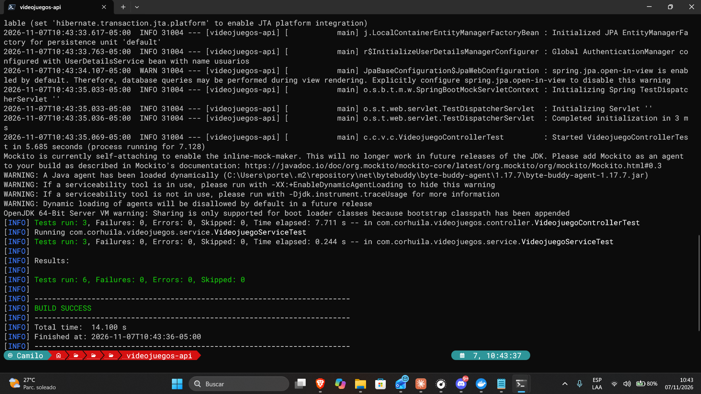

**2. Pruebas del frontend** — Con `npm test` corren las 3 pruebas del componente `Videojuegos`, cada una con su nombre, y pasan todas (`Tests 3 passed (3)`).

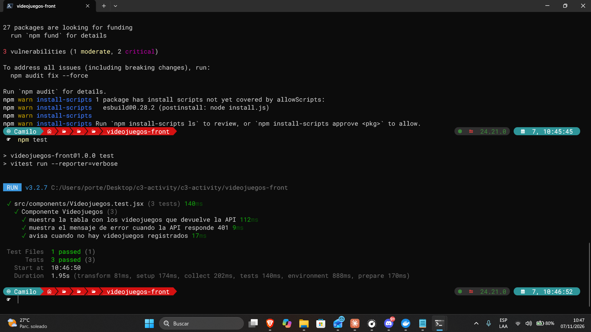

**3. Construcción de las imágenes** — Con `docker compose build` se construyen las dos imágenes, `videojuegos-api` y `videojuegos-front`, a partir de sus Dockerfiles, sin errores.

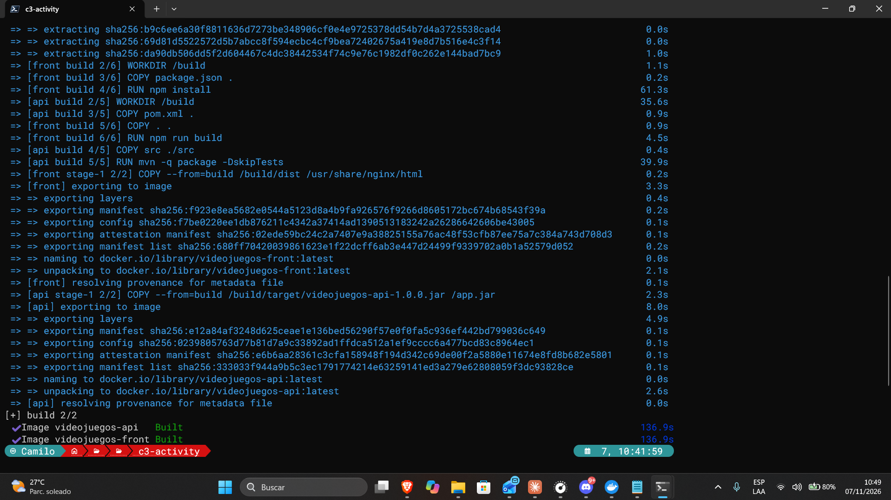

**4. Contenedores en ejecución** — Con `docker compose up -d` levanto los dos contenedores y con `docker ps` compruebo que están corriendo: `videojuegos-api` en el puerto `8080` y `videojuegos-front` en el `5173`.

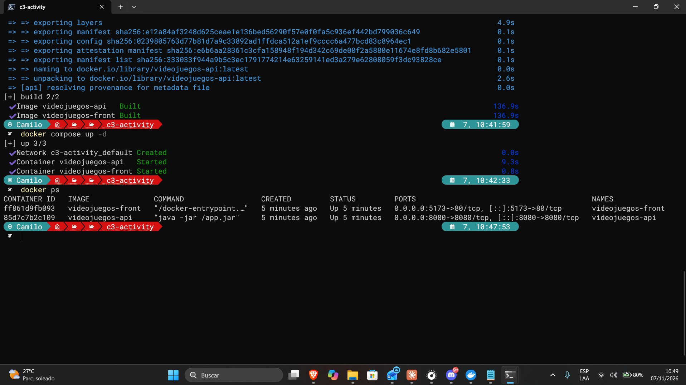

**5. Login correcto** — En Postman, `POST http://localhost:8080/api/auth/login` con `admin` / `admin123` (la API corriendo en el contenedor) responde `200 OK` con el token en el cuerpo.

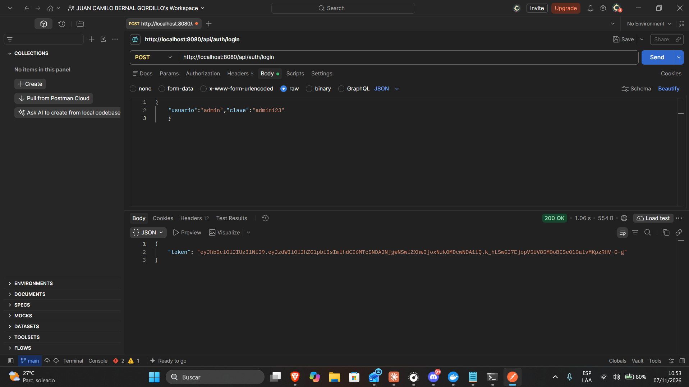

**6. Login incorrecto** — El mismo login con una clave equivocada responde `401 Unauthorized`.

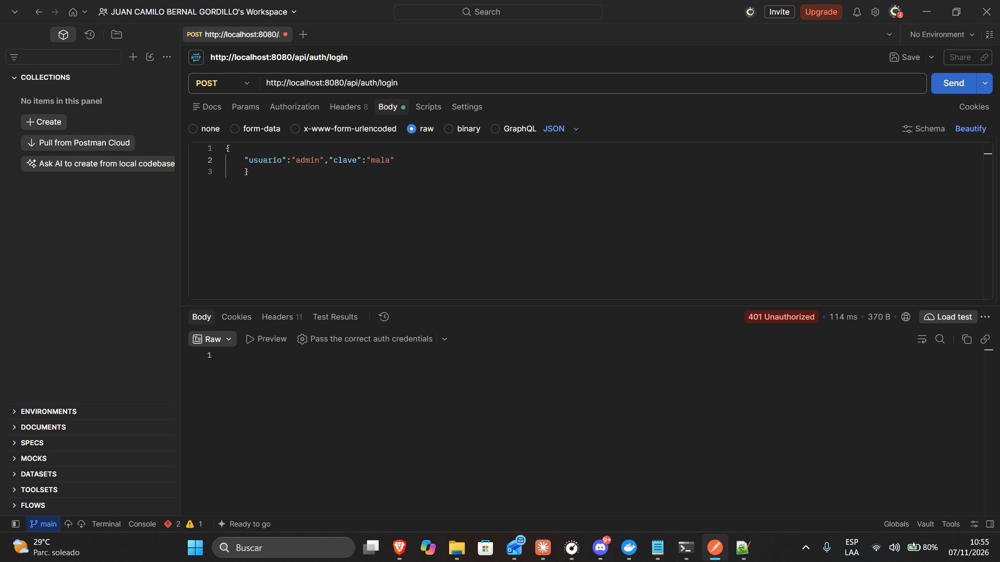

**7. Endpoint protegido sin token** — `GET http://localhost:8080/api/videojuegos` sin el token responde `401 Unauthorized`.

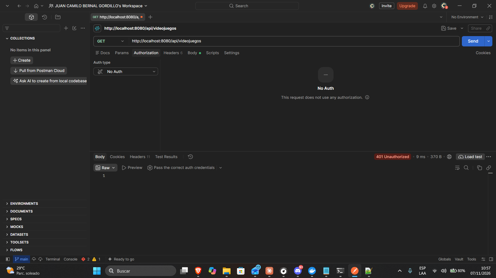

**8. Endpoint protegido con token** — La misma petición con la cabecera `Authorization: Bearer <token>` responde `200 OK` con los dos videojuegos: Red Dead Redemption 2 y Forza Horizon 5.

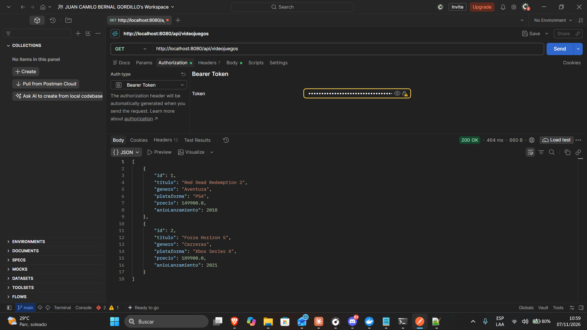

**9. Login en el frontend** — La aplicación de React, servida por el contenedor de nginx en `http://localhost:5173`, muestra el formulario de inicio de sesión.

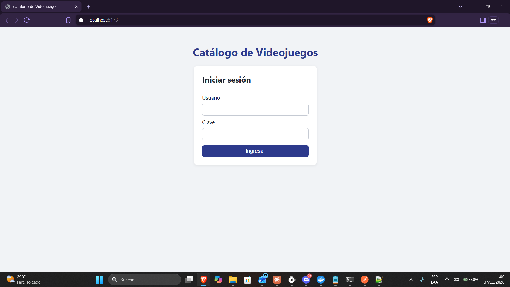

**10. Catálogo en el frontend** — Después de iniciar sesión con `admin` / `admin123`, la vista muestra la tabla con los dos videojuegos que trae de la API protegida.

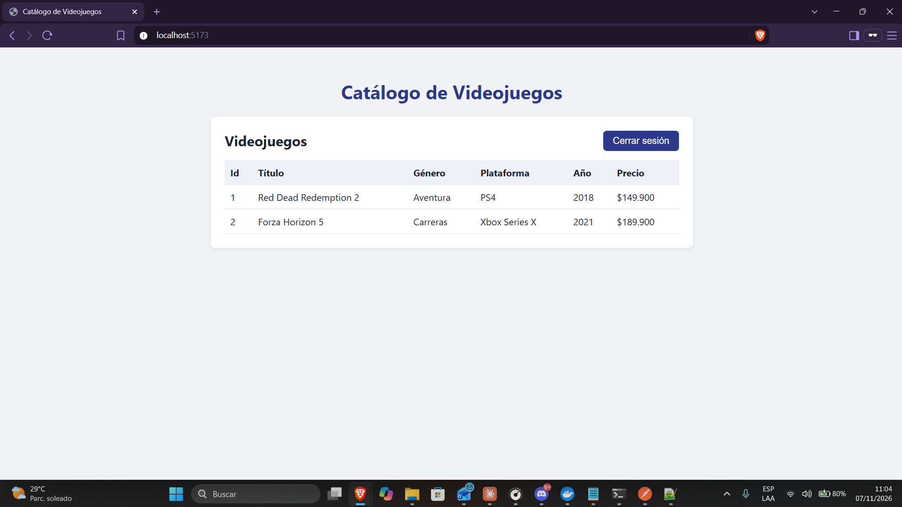

**11. CORS en el navegador** — En las herramientas de desarrollo (pestaña *Network*), la petición `GET` a `/api/videojuegos` sale con la cabecera `Authorization: Bearer ...` y la respuesta trae `Access-Control-Allow-Origin: http://localhost:5173`, que es lo que le permite al navegador entregarle los datos al frontend.

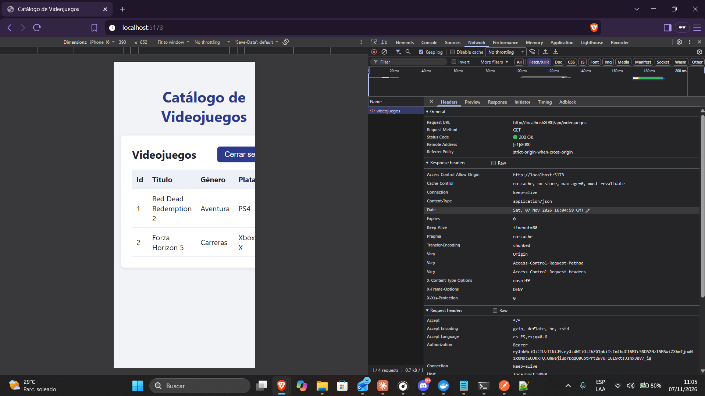

Con esto la aplicación funciona de punta a punta: el frontend inicia sesión, la API entrega un token, el token abre el catálogo protegido, todo corre en contenedores, y las pruebas me avisan en pocos segundos si algo se rompe, tanto cuando todo sale bien como cuando algo falla.
