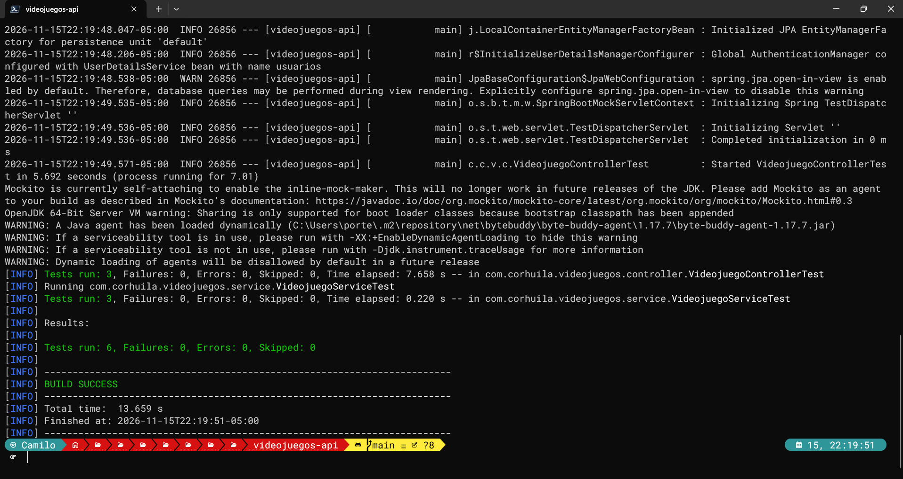
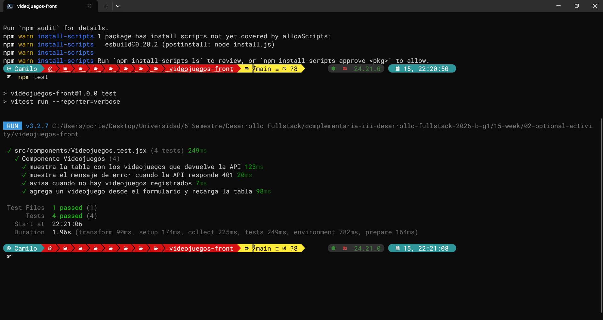
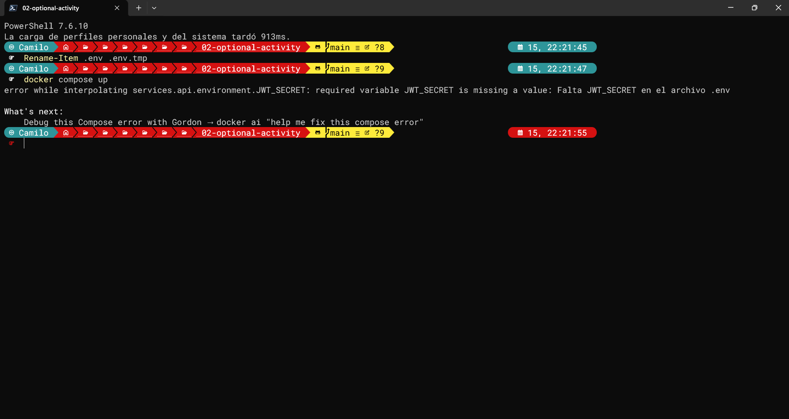
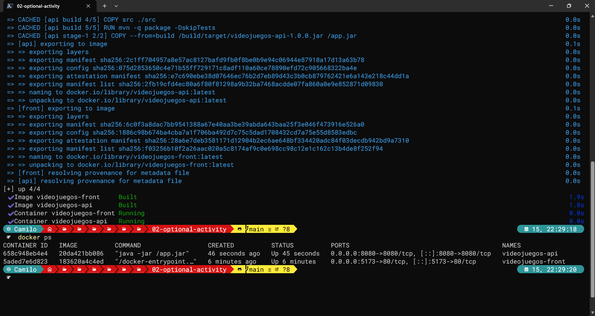
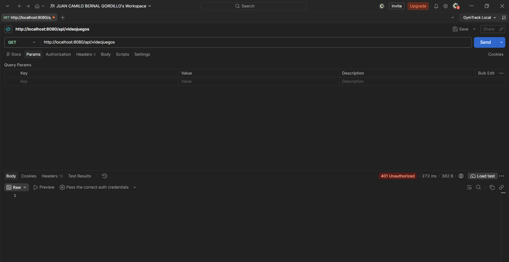
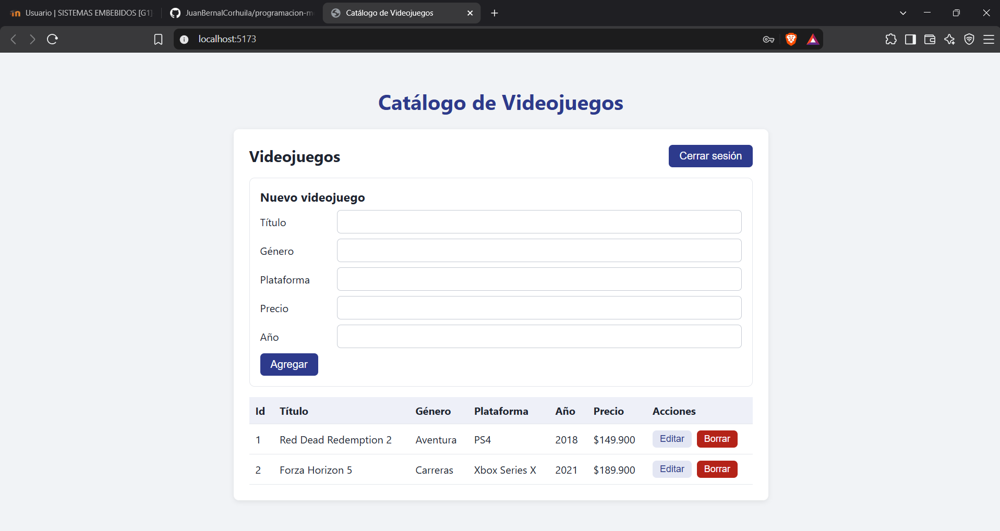
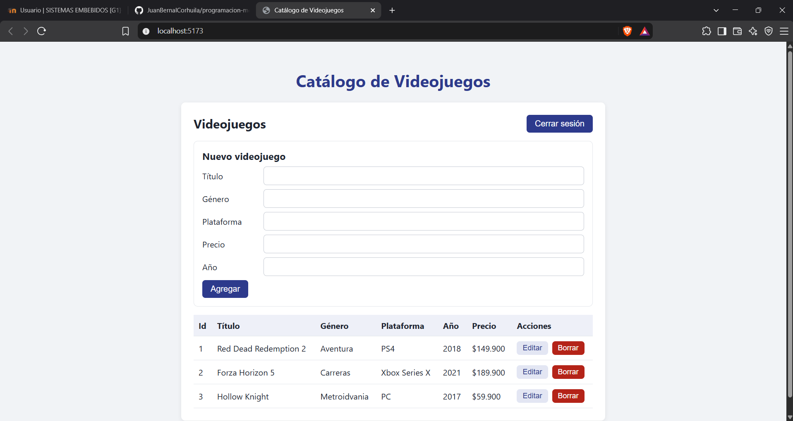
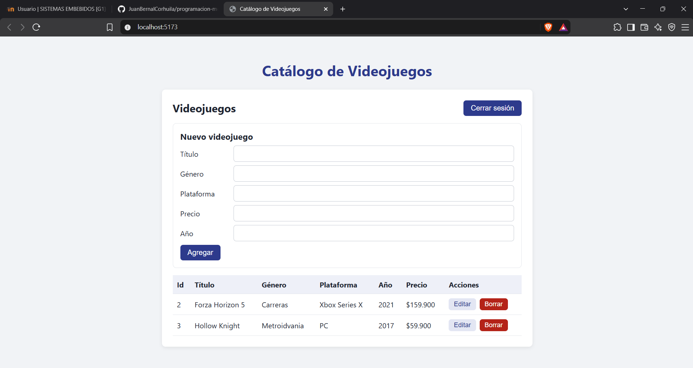
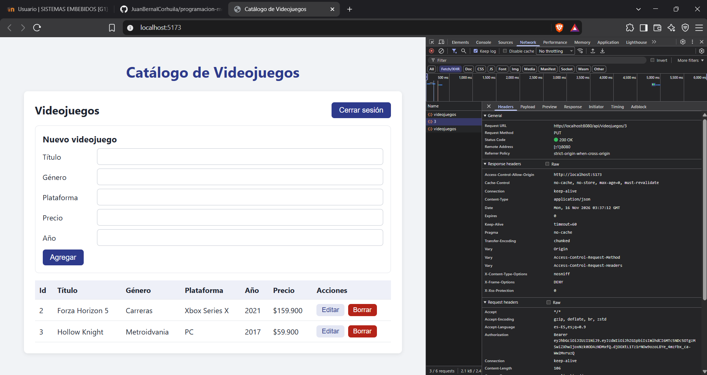

# Semana 15 · Consolidar y desplegar el proyecto — Catálogo de Videojuegos

| | |
| --- | --- |
| **Estudiante** | Juan Camilo Bernal Gordillo |
| **Materia** | Complementaria III - Profundización Desarrollo Fullstack (2026-B) |
| **Usuario de GitHub** | [JuanBernalCorhuila](https://github.com/JuanBernalCorhuila) |

Esta semana dejé mi catálogo de videojuegos listo para desplegar. Tomé la aplicación fullstack que ya tenía (frontend en React, API en Spring Boot, base de datos H2 y seguridad con JWT, todo en contenedores) y le hice tres cosas:

- **La integré de punta a punta:** antes el frontend solo iniciaba sesión y listaba los videojuegos. Ahora desde la pantalla también puedo crear, editar y borrar, así que todo el CRUD de la API se usa desde el navegador y con el token.
- **Saqué la configuración del código:** la clave del JWT, el origen permitido en CORS, la URL de la base de datos y la dirección de la API que usa el frontend ahora salen de variables de entorno. Son justo los valores que cambian entre mi equipo y un servidor en la nube.
- **La desplegué:** la levanto en mi equipo con Docker Compose leyendo esas variables desde un archivo `.env`, y dejé el paso a paso para subirla a una máquina virtual de AWS (EC2) cambiando solo ese archivo.

La entidad, las capas y los endpoints de la API son los mismos de las semanas anteriores. Copié aquí el proyecto completo para que esta carpeta funcione sola, sin depender de otras.

```
                          archivo .env  (JWT_SECRET, CORS_ORIGIN, VITE_API_URL)
                                │
                         docker compose up
                ┌───────────────┴────────────────┐
                ▼                                ▼
[ front: React + nginx (puerto 5173) ]   [ api: Spring Boot (puerto 8080) ]
        │                                        │
        ├── POST /api/auth/login ───────────────►│ usuario y clave ─► token JWT
        ├── GET / POST / PUT / DELETE            │
        │   /api/videojuegos                     │
        │   Authorization: Bearer <token> ──────►│ JwtFilter ─► controller ─► service ─► repository ─► H2
        ◄────────────── JSON / 201 / 204 ────────┘
```

## 1. Estructura del proyecto

```
02-optional-activity/
├── README.md
├── .env.example                             (nuevo: plantilla de las variables de entorno)
├── .gitignore                               (nuevo: evita subir el .env real)
├── docker-compose.yml                       (cambió: pasa las variables a los contenedores)
├── evidencias/
├── videojuegos-api/                         (backend)
│   ├── Dockerfile
│   ├── .dockerignore
│   ├── pom.xml
│   └── src/
│       ├── main/
│       │   ├── java/com/corhuila/videojuegos/
│       │   │   ├── VideojuegosApiApplication.java
│       │   │   ├── model/Videojuego.java
│       │   │   ├── repository/VideojuegoRepository.java
│       │   │   ├── service/VideojuegoService.java
│       │   │   ├── controller/
│       │   │   │   ├── VideojuegoController.java     (cambió: el origen de CORS ya no está escrito a mano)
│       │   │   │   └── AuthController.java           (cambió: igual)
│       │   │   ├── dto/
│       │   │   └── security/
│       │   └── resources/application.properties      (cambió: lee variables de entorno)
│       └── test/java/com/corhuila/videojuegos/
│           ├── service/VideojuegoServiceTest.java
│           └── controller/VideojuegoControllerTest.java  (cambió: clave JWT solo para pruebas)
└── videojuegos-front/                       (frontend en React con Vite)
    ├── Dockerfile                           (cambió: recibe la URL de la API al construir)
    ├── .env.development                     (nuevo: URL de la API para npm run dev)
    ├── package.json
    ├── vite.config.js
    └── src/
        ├── App.jsx
        ├── App.css                          (cambió: estilos del formulario y los botones)
        ├── api.js                           (cambió: URL desde variable de entorno y CRUD completo)
        └── components/
            ├── Login.jsx
            ├── Videojuegos.jsx              (cambió: botones de editar y borrar)
            ├── VideojuegoForm.jsx           (nuevo: formulario para crear y editar)
            └── Videojuegos.test.jsx         (cambió: prueba de crear)
```

## 2. La aplicación de punta a punta

Cada acción de la pantalla pasa por todas las partes del proyecto: React llama a la API con el token, el `JwtFilter` lo valida, el controller le pasa la petición al service, el service usa el repository y el repository guarda en H2.

| En la pantalla | Petición | Respuesta |
| --- | --- | --- |
| Inicio sesión con `admin` / `admin123` | `POST /api/auth/login` | `200` con el token (o `401`) |
| Se abre el catálogo | `GET /api/videojuegos` | `200` con la lista |
| Lleno el formulario y doy *Agregar* | `POST /api/videojuegos` | `201` con el videojuego creado |
| Doy *Editar*, cambio datos y *Guardar cambios* | `PUT /api/videojuegos/{id}` | `200` (o `404` si ya no existe) |
| Doy *Borrar* y confirmo | `DELETE /api/videojuegos/{id}` | `204` (o `404`) |
| Cualquiera de las anteriores con un token vencido o falso | — | `401`, y la pantalla muestra el mensaje para volver a iniciar sesión |

### El CRUD en el frontend

En `api.js` agregué las tres llamadas que faltaban. Como todas las peticiones protegidas llevan las mismas cabeceras y manejan los mismos errores, lo dejé en dos funciones pequeñas que reutilizan todas:

```js
function cabeceras() {
  return {
    "Content-Type": "application/json",
    Authorization: `Bearer ${localStorage.getItem("token")}`,
  };
}

export async function actualizarVideojuego(id, videojuego) {
  const res = await pedir(`${API_URL}/videojuegos/${id}`, {
    method: "PUT",
    headers: cabeceras(),
    body: JSON.stringify(videojuego),
  });
  revisar(res);   // 401, 404 u otro error -> mensaje claro
  return res.json();
}
```

Hice un solo formulario, `VideojuegoForm.jsx`, que sirve para crear y para editar: si recibe un videojuego, arranca con sus datos y el botón dice *Guardar cambios*; si no, arranca vacío y dice *Agregar*. Los campos de precio y año los convierto a número antes de enviarlos, porque así los espera la entidad.

En `Videojuegos.jsx` cada fila tiene los botones *Editar* y *Borrar*. Después de crear, editar o borrar vuelvo a pedir la lista a la API, así la tabla siempre muestra lo que de verdad quedó guardado en la base de datos:

```jsx
async function guardar(datos) {
  if (editando) {
    await actualizarVideojuego(editando.id, datos);
  } else {
    await crearVideojuego(datos);
  }
  setEditando(null);
  cargar();
}
```

Antes de borrar se pide confirmación, para no eliminar un videojuego por un clic accidental.

## 3. Configuración con variables de entorno

Hasta la semana pasada la clave del JWT estaba escrita en `application.properties` y las direcciones `http://localhost:5173` y `http://localhost:8080` estaban en el código. Eso funciona en mi equipo, pero en un servidor esas direcciones son otras, y una clave secreta escrita en el código queda a la vista de cualquiera que vea el repositorio. Por eso las pasé a variables de entorno:

| Variable | Para qué sirve | ¿Obligatoria? | En mi equipo |
| --- | --- | --- | --- |
| `JWT_SECRET` | Clave con la que la API firma los tokens | Sí | La que yo ponga en `.env` |
| `CORS_ORIGIN` | Dirección del frontend que la API deja entrar | No | `http://localhost:5173` |
| `DB_URL` | Conexión a la base de datos | No | `jdbc:h2:mem:videojuegosdb` |
| `JWT_EXPIRACION_MS` | Duración del token | No | `3600000` (1 hora) |
| `VITE_API_URL` | Dirección de la API que usa el frontend | Se usa al construir | `http://localhost:8080/api` |

### En la API: `application.properties`

Spring Boot lee las variables de entorno con `${VARIABLE:valor por defecto}`. A las que no son secretas les dejé un valor por defecto que sirve en local; a la clave del JWT no, a propósito: si falta, la API no arranca, en vez de arrancar con una clave conocida por todos. La clave además tiene que tener al menos 32 caracteres (256 bits): con una más corta, la librería JWT la rechaza por insegura (`WeakKeyException`) y la API tampoco arranca.

```properties
spring.datasource.url=${DB_URL:jdbc:h2:mem:videojuegosdb}

jwt.secret=${JWT_SECRET}
jwt.expiracion-ms=${JWT_EXPIRACION_MS:3600000}

app.cors.origin=${CORS_ORIGIN:http://localhost:5173}
```

En los controladores cambié el origen escrito a mano por esa propiedad. Spring reemplaza el `${...}` al arrancar:

```java
@CrossOrigin(origins = "${app.cors.origin}")
@RestController
@RequestMapping("/api/videojuegos")
public class VideojuegoController { /* ... */ }
```

Como ahora la clave es obligatoria, en la prueba de integración (que levanta la aplicación completa) le doy una que solo existe para las pruebas:

```java
@SpringBootTest(properties = "JWT_SECRET=clave-solo-para-las-pruebas-de-videojuegos-api")
```

### En el frontend: `api.js`, `.env.development` y el `Dockerfile`

Vite expone en el código las variables que empiezan por `VITE_`:

```js
const API_URL = import.meta.env.VITE_API_URL;
```

Hay una diferencia importante con el backend: React corre en el navegador, no en el servidor, así que la variable no se lee mientras la aplicación está funcionando, sino que Vite la deja escrita en el JavaScript cuando la construye (`npm run build`). Por eso:

- Con `npm run dev` el valor sale de `.env.development` (`http://localhost:8080/api`). No es un secreto: es una dirección que de todas formas termina visible en el navegador.
- En Docker llega como argumento de construcción. En el `Dockerfile` lo recibo con `ARG` justo antes del `npm run build`:

```dockerfile
COPY . .
ARG VITE_API_URL
RUN npm run build
```

### Juntando todo: `.env` y `docker-compose.yml`

Los valores reales los pongo en un archivo `.env` al lado del `docker-compose.yml`. Docker Compose lo lee solo y reemplaza cada `${...}`:

```yaml
api:
  environment:
    JWT_SECRET: ${JWT_SECRET:?Falta JWT_SECRET en el archivo .env}
    CORS_ORIGIN: ${CORS_ORIGIN:-http://localhost:5173}

front:
  build:
    context: ./videojuegos-front
    args:
      VITE_API_URL: ${VITE_API_URL:-http://localhost:8080/api}
```

`:?` hace que Compose se detenga con ese mensaje si falta la clave, y `:-` pone un valor por defecto. La API recibe sus variables como `environment` (las lee al arrancar el contenedor) y el frontend como `args` (las necesita al construir la imagen).

El `.env` tiene la clave secreta, así que no se sube a GitHub: lo agregué al `.gitignore`. Lo que sí está en el repositorio es `.env.example`, una plantilla con las mismas variables y valores de ejemplo, para que quien clone el proyecto sepa qué tiene que llenar.

## 4. Pruebas

Las pruebas de las semanas anteriores siguen pasando, y agregué una para el formulario nuevo.

- **Backend (6 pruebas):** 3 unitarias del service (con el repository simulado con Mockito) y 3 de integración de los endpoints con MockMvc, que incluyen el `404` de un id que no existe y el `401` sin token.
- **Frontend (4 pruebas):** las 3 del componente `Videojuegos` (tabla con datos, mensaje de error `401` y lista vacía) y una nueva que llena el formulario, da *Agregar* y comprueba que se llamó a la API con los datos correctos y que el videojuego nuevo aparece en la tabla.

```bash
# Backend (desde videojuegos-api)
mvn test

# Frontend (desde videojuegos-front)
npm install
npm test
```

## 5. Despliegue local con Docker

Solo necesito tener Docker Desktop abierto. Desde esta carpeta (`02-optional-activity`):

**1. Crear el `.env` a partir de la plantilla** y cambiar `JWT_SECRET` por una clave propia de 32 caracteres o más:

```powershell
Copy-Item .env.example .env
```

**2. Construir y levantar los dos contenedores:**

```bash
docker compose up -d --build
docker ps
```

**3. Entrar a la aplicación:**

- Frontend: http://localhost:5173 (inicio sesión con `admin` / `admin123`)
- API: http://localhost:8080 (documentación en http://localhost:8080/swagger-ui.html)

Hay que entrar por `localhost` y no por `127.0.0.1`, porque ese es el origen que tiene permitido CORS.

**4. Detener todo:**

```bash
docker compose down
```

La base H2 está en memoria dentro del contenedor de la API: cada vez que se detiene, vuelve a arrancar con los dos videojuegos iniciales.

### Sin Docker

Necesito Java 17 o superior, Maven y Node.js 20.19 o superior. La API necesita la clave en una variable de entorno; en PowerShell la defino en la misma terminal antes de arrancar:

```powershell
# Backend (desde videojuegos-api)
$env:JWT_SECRET="una-clave-propia-de-32-o-mas-caracteres"
mvn spring-boot:run

# Frontend (desde videojuegos-front, en otra terminal)
npm install
npm run dev
```

## 6. Despliegue en la nube (AWS EC2)

En mi equipo la aplicación solo la puedo usar yo; en la nube queda en un servidor encendido todo el tiempo y cualquiera la abre desde internet. Como ya está en contenedores, la forma más directa es una máquina virtual de AWS (EC2) con Docker, donde corro exactamente el mismo `docker-compose.yml`. Lo único que cambia es el `.env`:

| Variable | En mi equipo | En la EC2 |
| --- | --- | --- |
| `JWT_SECRET` | Una clave de prueba | Una clave distinta y larga, que solo esté en el servidor |
| `CORS_ORIGIN` | `http://localhost:5173` | `http://<IP-pública>:5173` |
| `VITE_API_URL` | `http://localhost:8080/api` | `http://<IP-pública>:8080/api` |

`VITE_API_URL` también cambia porque el que llama a la API es el navegador de quien abre la página, no el servidor; si quedara `localhost`, el navegador buscaría la API en el computador del usuario.

El paso a paso:

**1. Crear la instancia.** En la consola de AWS, en EC2 → *Launch instance*: sistema Ubuntu Server 24.04, tipo `t3.micro` o `t2.micro` (los de la capa gratuita) y un par de claves (*key pair*) nuevo, que descargo como archivo `.pem` para conectarme.

**2. Abrir los puertos.** En el grupo de seguridad (*security group*) de la instancia agrego reglas de entrada para el puerto `22` (SSH, solo desde mi IP), el `5173` (frontend) y el `8080` (API), estos dos desde cualquier lugar (`0.0.0.0/0`).

**3. Conectarme por SSH** con la IP pública que muestra la consola:

```bash
ssh -i mi-clave.pem ubuntu@<IP-pública>
```

**4. Instalar Docker y Git en la instancia:**

```bash
sudo apt update
sudo apt install -y docker.io docker-compose-v2 git
sudo usermod -aG docker ubuntu
exit
```

`usermod` me permite usar `docker` sin `sudo`; hay que salir y volver a conectarse para que tome efecto.

**5. Traer el proyecto y crear el `.env` del servidor:**

```bash
git clone https://github.com/JuanBernalCorhuila/complementaria-iii-desarrollo-fullstack-2026-b-g1.git
cd complementaria-iii-desarrollo-fullstack-2026-b-g1/15-week/02-optional-activity
cp .env.example .env
nano .env
```

En `nano` pongo una clave nueva en `JWT_SECRET` y reemplazo `localhost` por la IP pública en `CORS_ORIGIN` y `VITE_API_URL`.

**6. Levantar la aplicación:**

```bash
docker compose up -d --build
docker ps
```

**7. Probar** abriendo `http://<IP-pública>:5173` en el navegador e iniciando sesión.

Algunas cosas a tener en cuenta:

- La primera construcción compila la API con Maven dentro del contenedor; en una instancia de 1 GB de memoria puede tardar varios minutos.
- Si detengo y vuelvo a iniciar la instancia, AWS le asigna otra IP pública y tengo que actualizar el `.env` y volver a ejecutar `docker compose up -d --build` (o asignarle una IP fija, una *Elastic IP*).
- Cuando termine de usarla, la detengo o la elimino desde la consola para no consumir horas de la capa gratuita.
- Para algo en producción de verdad el siguiente paso sería cambiar H2 por una base de datos gestionada (por ejemplo Amazon RDS): bastaría con cambiar `DB_URL` y agregar el driver de esa base al `pom.xml`, porque el resto del código no cambia.

## 7. Evidencias

**1. Pruebas del backend** — Con `mvn test` pasan las 6 pruebas: `Tests run: 6, Failures: 0, Errors: 0` y `BUILD SUCCESS`.



**2. Pruebas del frontend** — Con `npm test` pasan las 4 pruebas del componente `Videojuegos`, incluida la nueva de agregar un videojuego (`Tests 4 passed (4)`).



**3. Sin `.env` no arranca** — Si ejecuto `docker compose up` sin haber creado el `.env`, Compose se detiene con el mensaje `Falta JWT_SECRET en el archivo .env` y no levanta nada.



**4. Contenedores en ejecución** — Con el `.env` creado, `docker compose up -d --build` levanta los dos contenedores y `docker ps` muestra `videojuegos-api` en el puerto `8080` y `videojuegos-front` en el `5173`.



**5. Endpoint protegido sin token** — En Postman, `GET http://localhost:8080/api/videojuegos` sin token responde `401 Unauthorized`: la seguridad con JWT sigue funcionando con la clave que viene del `.env`.



**6. Catálogo después del login** — En `http://localhost:5173`, después de iniciar sesión con `admin` / `admin123`, se ve el formulario y la tabla con los dos videojuegos iniciales: Red Dead Redemption 2 (id 1) y Forza Horizon 5 (id 2).



**7. Crear** — Con el formulario agrego *Hollow Knight* (Metroidvania, PC, 59900, 2017) y aparece en la tabla con el id 3.



**8. Editar** — Doy *Editar* en Forza Horizon 5, cambio el precio a 159900 y guardo. La tabla muestra el precio nuevo ($159.900).


**9. Borrar** — Doy *Borrar* en Red Dead Redemption 2 y confirmo. En la tabla quedan Forza Horizon 5 y Hollow Knight.



**10. Petición en el navegador** — En la pestaña *Network* de las herramientas de desarrollo, la petición `PUT` a `/api/videojuegos/3` (al editar Hollow Knight) responde `200 OK`, sale con la cabecera `Authorization: Bearer ...` y la respuesta trae `Access-Control-Allow-Origin: http://localhost:5173`, el origen que la API toma de la variable `CORS_ORIGIN`.



Con esto la aplicación queda completa de punta a punta y lista para llevarla a cualquier servidor: el mismo código y los mismos contenedores corren en mi equipo o en la nube, y lo único que cambia de un lugar a otro es el archivo `.env`.
