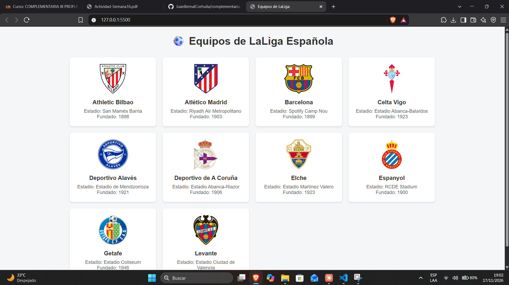
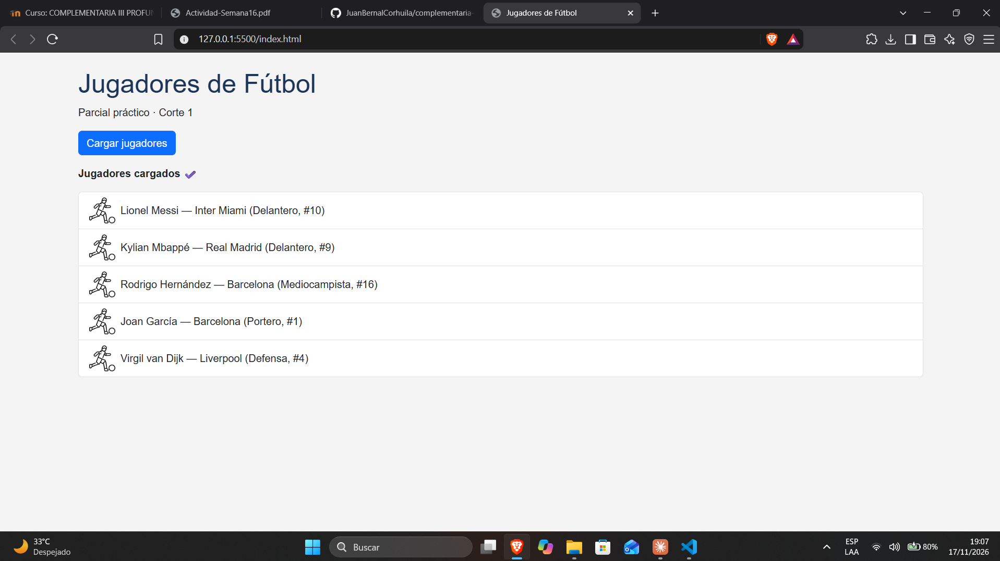
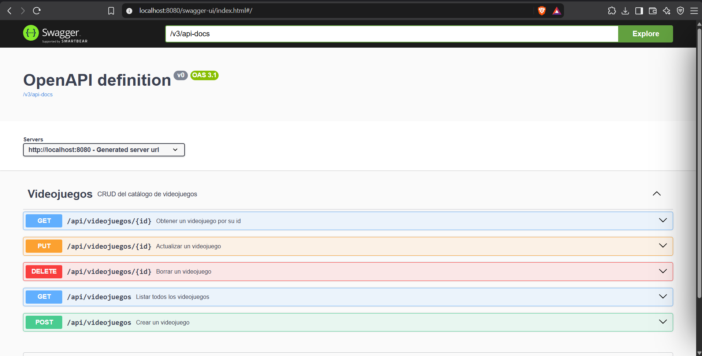
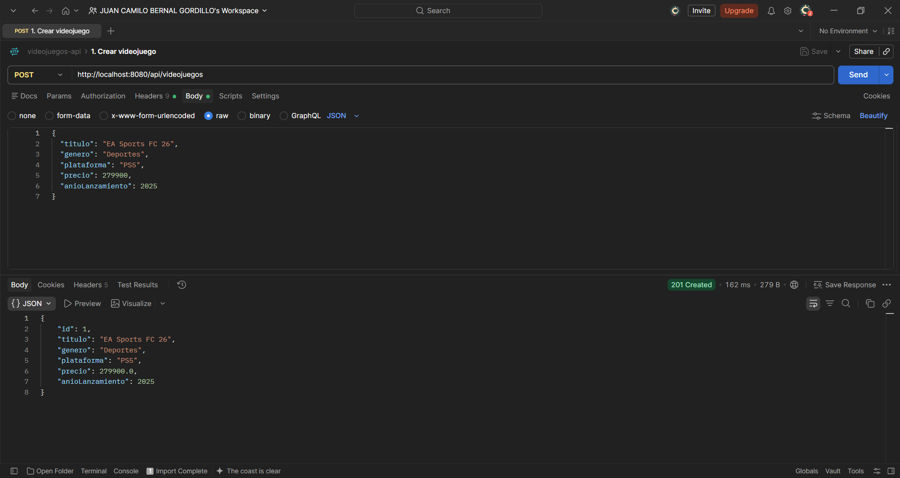
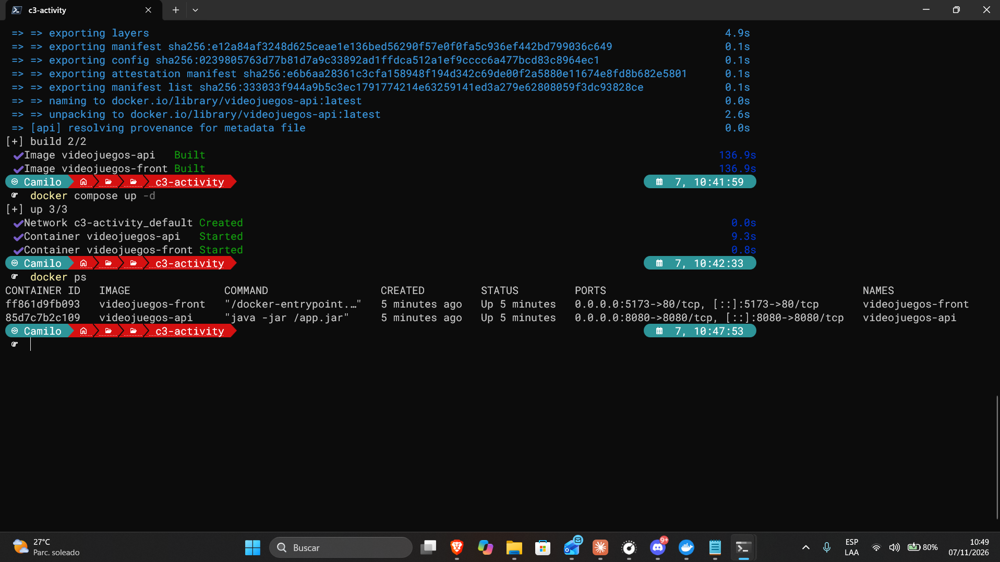
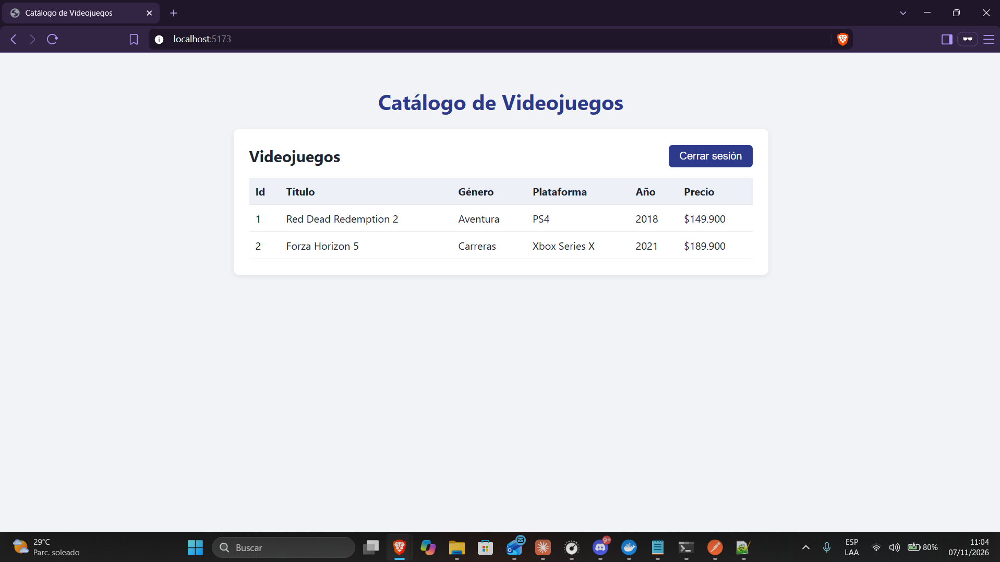
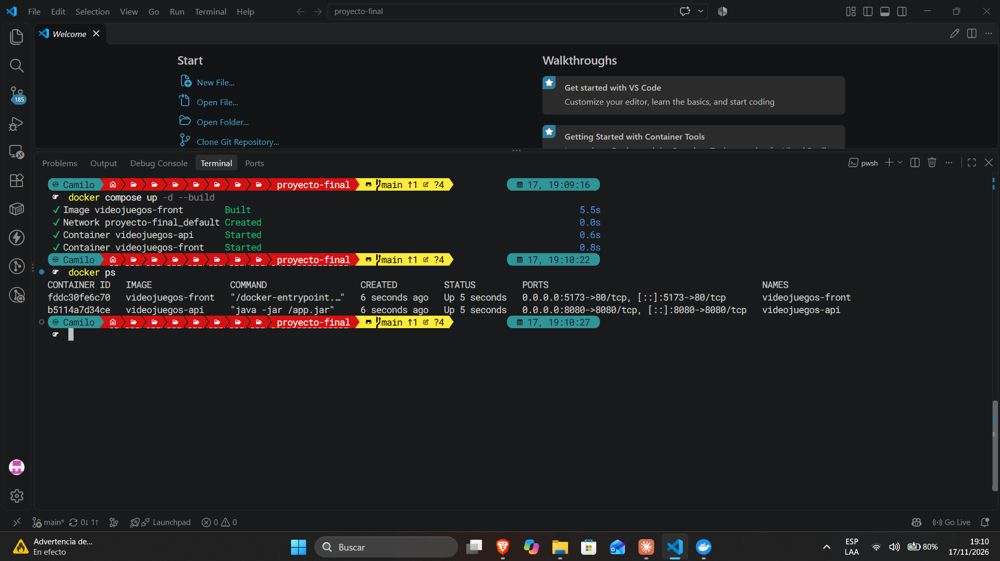
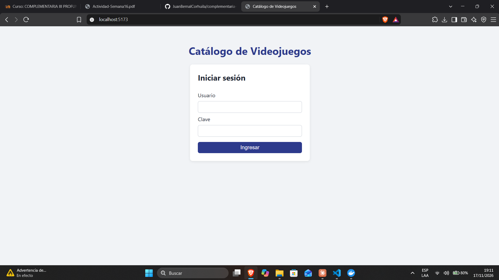
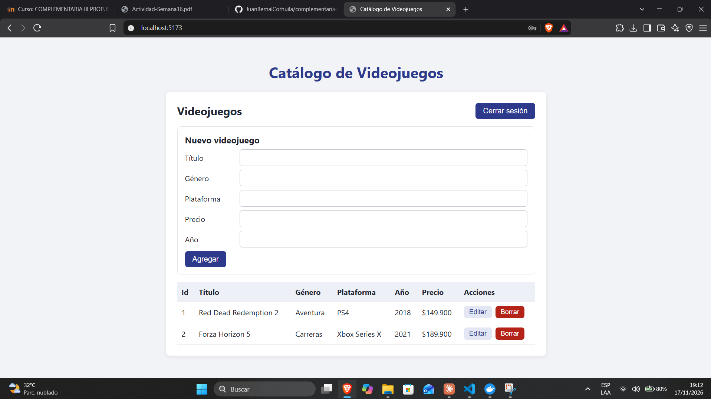
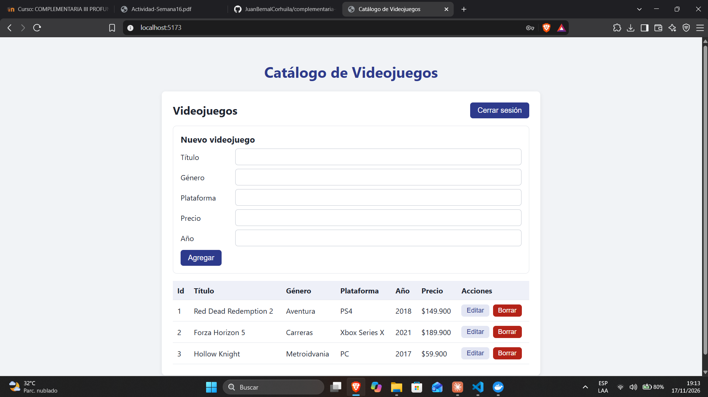

# Semana 16 · Portafolio y cierre — Desarrollo Fullstack

| | |
| --- | --- |
| **Estudiante** | Juan Camilo Bernal Gordillo |
| **Materia** | Complementaria III - Profundización Desarrollo Fullstack (2026-B) |
| **Usuario de GitHub** | [JuanBernalCorhuila](https://github.com/JuanBernalCorhuila) |

Este es mi portafolio del curso. Aquí reuní lo que entregué durante los tres cortes, con capturas de cada uno, y el proyecto final: mi catálogo de videojuegos, una aplicación fullstack completa con frontend en React, API en Spring Boot, seguridad con JWT, pruebas, contenedores con Docker y la configuración lista para llevarla a la nube.

Las capturas del corte 2 y del corte 3 son las mismas que tomé cuando hice esas entregas, por eso algunas tienen la fecha de ese momento. Las del corte 1 y las del proyecto final las tomé para este portafolio: las entregas del corte 1 no tenían capturas, y el proyecto final lo volví a ejecutar desde esta carpeta.

El recorrido fue de la interfaz hacia el despliegue: primero aprendí a hacer páginas y a consumir APIs de otros, después construí mi propia API y al final la protegí, la conecté con un frontend, la probé y la empaqueté.

```
Corte 1                        Corte 2                          Corte 3
Frontend                       Backend                          Seguridad, integración y despliegue
HTML/CSS/JS · fetch · React    Spring Boot · capas · JPA · H2   JWT · CORS · pruebas · Docker · variables de entorno
        │                              │                                    │
        └──── consume APIs ────► mi propia API REST ────► app fullstack segura, probada y en contenedores
                                                                            │
                                                                  Proyecto final (videojuegos)
```

## 1. Estructura de la carpeta

```
02-optional-activity/
├── README.md                    (este portafolio)
├── evidencias/                  (capturas de cada corte y del proyecto final)
└── proyecto-final/              (la aplicación completa, lista para ejecutar)
    ├── .env.example             (plantilla de las variables de entorno)
    ├── .gitignore               (evita subir el .env real)
    ├── docker-compose.yml       (levanta la API y el frontend juntos)
    ├── videojuegos-api/         (backend: Spring Boot)
    └── videojuegos-front/       (frontend: React con Vite)
```

En `proyecto-final/` copié la versión final de mi aplicación, la misma de la semana 15, sin cambios. La puse aquí para que esta carpeta funcione sola: con ella se puede ejecutar el proyecto siguiendo la sección 5, sin depender de otras semanas.

## 2. Corte 1 — Fundamentos web y frontend

En este corte trabajé solo del lado del navegador: HTML semántico, CSS en su propio archivo, JavaScript para el comportamiento, consumo de APIs con `fetch` manejando los estados de carga, datos y error, y una primera vista con React.

| Semana | Entrega | Qué hice |
| --- | --- | --- |
| 1 | [Presentación](../../01-week/02-optional-activity/) | Me presenté y escribí lo que esperaba del curso. |
| 2 | [Mundial 2026 · Datos rápidos](../../02-week/02-optional-activity/) | Mi primera página con HTML, CSS y JavaScript separados; un botón muestra un dato curioso. |
| 3 | [Pokédex](../../03-week/02-optional-activity/) | Primero el mockup de la vista y luego las tarjetas con datos reales de la PokeAPI, pedidos con `fetch`, con mensajes de carga y de error. |
| 4 | [Equipos de fútbol con React](../../04-week/02-optional-activity/) | La misma idea de mostrar equipos, pero armada con componentes de React. |
| 4 | **[Actividad calificable C1 · Equipos de LaLiga](../../04-week/c1%20-%20Activity/)** | Consumo la API pública de TheSportsDB con `fetch` y muestro los equipos en tarjetas, con estado de carga, de error y un botón para reintentar. |
| 5 | [Selección Colombia con json-server](../../05-week/02-optional-activity/actividad-semana-5/case-1/) | Un mini-frontend que le pide los convocados a una API local simulada con json-server. |
| 5 | **[Parcial práctico C1](../../05-week/02-optional-activity/c1-practical-exam/case-1/)** | Una vista que carga una lista de jugadores desde mi propia API con json-server, más la explicación de componente, estado, enrutamiento y SPA. |

**Actividad calificable C1** — La página de equipos de LaLiga con las tarjetas que trae de TheSportsDB (escudo, estadio y año de fundación).

Al volver a abrirla para este portafolio, la página mostraba su mensaje de error: TheSportsDB desactivó la clave gratuita `3` que usaba la URL y ahora la clave de prueba es `123`. Cambié solo ese número en `script.js` y la página volvió a cargar los equipos.



**Parcial práctico C1** — Al dar clic en *Cargar jugadores*, la vista le pide los datos a json-server (`http://localhost:3000/jugadores`) y muestra los cinco jugadores.



## 3. Corte 2 — Backend y API REST

Aquí elegí el caso que me acompañó el resto del curso: un catálogo de videojuegos. Primero lo diseñé en capas y después lo fui construyendo hasta tener una API REST completa, documentada y probada.

| Semana | Entrega | Qué hice |
| --- | --- | --- |
| 6 | [Arquitectura en capas](../../06-week/02-optional-activity/) | El diagrama de capas del catálogo (controller → service → repository → entity) y la responsabilidad de cada una. |
| 7 | [Entity y repository](../../07-week/02-optional-activity/) | La entidad `Videojuego` mapeada con JPA y su repositorio, con una consulta por género. |
| 8 | [CRUD REST](../../08-week/02-optional-activity/) | El proyecto `videojuegos-api` en Spring Boot con H2 y los cinco endpoints del CRUD, probados en Postman. |
| 9 | [Documentar y probar la API](../../09-week/02-optional-activity/actividad-opcional/) | La documentación con Swagger y las pruebas en Postman, incluido un caso de error. |
| 9 | **[Actividad calificable C2 · API REST de videojuegos](../../09-week/02-optional-activity/c2-activity/)** | La API completa: capas, JPA con H2, los cinco endpoints, Swagger y la colección de Postman con el ciclo entero del CRUD y el `404`. |
| 10 | [API probada](../../10-week/02-optional-activity/) | Junté todo el corte en un solo proyecto y volví a probarlo para dejarlo listo para un frontend. |

**Swagger de la API** — En `http://localhost:8080/swagger-ui.html` aparecen los cinco endpoints de `/api/videojuegos` y el esquema de `Videojuego`.



**Crear un videojuego en Postman** — `POST /api/videojuegos` con los datos de EA Sports FC 26 responde `201 Created` y devuelve el videojuego con `id: 1`.



## 4. Corte 3 — Seguridad, integración, pruebas y despliegue

Con la API lista, en este corte la protegí, le hice un frontend que la usa, le escribí pruebas automáticas, la metí en contenedores y saqué la configuración del código para poder desplegarla.

| Semana | Entrega | Qué hice |
| --- | --- | --- |
| 11 | [Proteger la API con JWT](../../11-week/02-optional-activity/) | Un login que devuelve un token y endpoints que responden `401` si la petición no lo trae. |
| 12 | [Integrar frontend y backend](../../12-week/02-optional-activity/) | El frontend en React con Vite: login, token guardado y tabla del catálogo; habilité CORS en la API. |
| 13 | [Pruebas de la aplicación](../../13-week/02-optional-activity/) | Pruebas unitarias y de integración en el backend (JUnit, Mockito, MockMvc) y del componente en el frontend (Vitest), con casos de error. |
| 14 | [Contenerizar con Docker](../../14-week/02-optional-activity/actividad-opcional/) | El `Dockerfile` de la API, la imagen y el contenedor respondiendo en el puerto 8080. |
| 14 | **[Actividad calificable C3 · App fullstack segura y probada](../../14-week/02-optional-activity/c3-activity/)** | Todo junto: JWT, frontend con CORS, pruebas en las dos partes y un `docker-compose.yml` que levanta la API y el frontend. |
| 15 | [Consolidar y desplegar](../../15-week/02-optional-activity/) | El CRUD completo desde la pantalla, la configuración en variables de entorno y el paso a paso para desplegar en AWS EC2. |

**Contenedores de la actividad C3** — Con las imágenes ya construidas, `docker compose up -d` levanta los dos contenedores y `docker ps` muestra `videojuegos-api` en el puerto `8080` y `videojuegos-front` en el `5173`.



**Catálogo en el frontend** — Después de iniciar sesión con `admin` / `admin123`, la vista muestra los dos videojuegos que trae de la API protegida: Red Dead Redemption 2 y Forza Horizon 5.



## 5. Proyecto final — Catálogo de Videojuegos

Es la aplicación en la que terminó todo el curso. Desde el navegador inicio sesión y administro el catálogo (listar, agregar, editar y borrar videojuegos), y cada acción viaja con el token hasta la API, que la valida y la guarda en la base de datos.

```
[ Navegador: React (localhost:5173) ]
        │  POST /api/auth/login ─────────────► token JWT
        │  GET / POST / PUT / DELETE /api/videojuegos
        │  Authorization: Bearer <token>
        ▼
[ API Spring Boot (localhost:8080) ] ─► JwtFilter ─► controller ─► service ─► repository ─► H2
```

| Parte | Tecnología |
| --- | --- |
| Frontend | React con Vite, servido por nginx en el contenedor |
| Backend | Spring Boot (Java 17, Maven) en capas: entity, repository, service y controller |
| Base de datos | H2 en memoria con JPA |
| Seguridad | Spring Security con JWT y CORS |
| Documentación | Swagger (springdoc) en `/swagger-ui.html` |
| Pruebas | 6 en el backend (JUnit, Mockito, MockMvc) y 4 en el frontend (Vitest, React Testing Library) |
| Contenedores | Un `Dockerfile` por parte y `docker-compose.yml` |
| Configuración | Variables de entorno en un archivo `.env` (clave JWT, origen de CORS, URL de la API) |

### Repositorio

- Código: [`16-week/02-optional-activity/proyecto-final`](https://github.com/JuanBernalCorhuila/complementaria-iii-desarrollo-fullstack-2026-b-g1/tree/main/16-week/02-optional-activity/proyecto-final)
- Explicación de cómo lo construí: [semana 15](../../15-week/02-optional-activity/), que es donde quedó terminado.

### URL

Por ahora la aplicación no tiene una URL pública: la ejecuto en mi equipo con Docker Compose. Ya está preparada para la nube, porque lo único que cambia de un lugar a otro es el `.env`; el paso a paso para subirla a una máquina virtual de AWS (EC2) lo dejé en la [semana 15](../../15-week/02-optional-activity/README.md#6-despliegue-en-la-nube-aws-ec2).

### Cómo ejecutarlo

Con Docker Desktop abierto, desde la carpeta `proyecto-final`:

**1. Crear el `.env`** a partir de la plantilla y cambiar `JWT_SECRET` por una clave propia de 32 caracteres o más. El `.env` no se sube al repositorio porque tiene la clave secreta.

```powershell
Copy-Item .env.example .env
```

**2. Construir y levantar los contenedores:**

```bash
docker compose up -d --build
docker ps
```

**3. Entrar a la aplicación:**

- Frontend: http://localhost:5173 (inicio sesión con `admin` / `admin123`)
- API: http://localhost:8080 (documentación en http://localhost:8080/swagger-ui.html)

**4. Detener todo:**

```bash
docker compose down
```

Sin Docker necesito Java 17 o superior, Maven y Node.js 20.19 o superior:

```powershell
# Backend (desde videojuegos-api)
$env:JWT_SECRET="una-clave-propia-de-32-o-mas-caracteres"
mvn spring-boot:run

# Frontend (desde videojuegos-front, en otra terminal)
npm install
npm run dev
```

Y para correr las pruebas: `mvn test` en `videojuegos-api` y `npm test` en `videojuegos-front`.

### El flujo completo funcionando

**Contenedores en ejecución** — Con el `.env` creado, `docker ps` muestra `videojuegos-api` en el puerto `8080` y `videojuegos-front` en el `5173`.



**Login** — En `http://localhost:5173` aparece la pantalla para iniciar sesión.



**Catálogo después del login** — Con `admin` / `admin123` entro y veo el formulario y la tabla con los dos videojuegos iniciales: Red Dead Redemption 2 (id 1) y Forza Horizon 5 (id 2).



**Agregar un videojuego** — Con el formulario agrego *Hollow Knight* (Metroidvania, PC, 59900, 2017) y aparece en la tabla con el id 3, guardado por la API.



## 6. Reflexión

Cuando empecé el curso sabía hacer páginas sueltas, pero no tenía claro cómo se conecta una interfaz con un servidor ni qué pasa entre el clic y el dato que aparece en pantalla. Ahora lo puedo contar de punta a punta, porque lo construí yo mismo: un botón en React hace una petición con el token, el filtro de seguridad la revisa, el controller se la pasa al service, el service usa el repository y el repository guarda en la base de datos.

Lo que más me sirvió fue haber trabajado el mismo catálogo de videojuegos desde la semana 6 hasta el final. Cada semana le agregaba una pieza sobre algo que ya funcionaba, y así entendí por qué se separa el código en capas: cuando llegaron la seguridad, el frontend o Docker, no tuve que reescribir la entidad ni los endpoints, solo sumar lo nuevo.

No todo fue fácil. Lo que más me costó fue ir construyendo la API y, sobre todo, levantarla sin que se perdieran las conexiones entre las partes: que la API hablara con la base de datos, que el frontend llegara a la API y, al final, que los contenedores se encontraran entre sí. Con JWT y CORS me pasó varias veces que todo estaba bien en Postman y el navegador igual bloqueaba la petición, hasta que entendí la petición previa `OPTIONS` y por qué tenía que dejarla pasar sin token. Y con Docker tardé en entender que `VITE_API_URL` no se lee mientras la aplicación corre, sino que queda escrita cuando se construye.

Aun así, disfruté mucho el proceso. Cada vez que algo que se había roto volvía a conectarse sentía que entendía un poco más cómo funciona todo por dentro, y ver mi catálogo funcionando de punta a punta, desde el login hasta los datos, fue de lo que más me gustó del curso. También aprendí a probar antes de dar algo por terminado y a no dejar secretos en el código, algo que al principio ni me preguntaba.

Mirando para atrás, en el primer corte varias entregas quedaron sin README ni capturas, y eso hace que hoy cueste más mostrarlas. Desde el segundo corte cada entrega tiene su explicación, cómo ejecutarla y su evidencia, y esa costumbre es la que más me llevo.

## 7. Mi próximo paso

Quiero que mi proyecto deje de vivir solo en mi equipo. Lo primero es aprender CI/CD con GitHub Actions, para que en cada `push` se ejecuten solas las pruebas del backend y del frontend y se construyan las imágenes de Docker. Después lo despliego de verdad en AWS EC2 y cambio H2 por PostgreSQL, para que los datos no se borren cada vez que se reinicia el contenedor. En paralelo quiero profundizar en React, que fue el framework con el que más cómodo me sentí, sobre todo en manejo de rutas y de estado.
